# 网络地址转换实验报告

张晨轩 2024K8009929011

## 1 实验目的

本实验是在用户态的路由转发框架之上完成TCP网络地址与端口转换的，在其中实现了SNAT、DNAT以及两个NAT串联时的HTTP访问。实验一方面检查连接能否建立，另一方面也比较页面内容、下载文件以及NAT两侧的报文，以此来验证映射与返回路径是否正确。

## 2 实验原理

### 2.1 SNAT与DNAT

SNAT的作用是让内网的客户端共享NAT的外部地址去访问服务器。去程当中会把源IP与源端口改为NAT外部IP和分配到的端口，回程则根据映射把内部的目的IP与端口恢复出来。

DNAT所做的是把外部地址上的服务端口映射到内网服务器。去程当中会把目的IP与端口改为规则里给出的内部地址与端口，回程再把内部服务器的源IP与端口还原成外部的服务地址。

### 2.2 映射表与方向判断

每一条映射都保存着内部、外部、远端三个IP/端口二元组。其中远端的二元组在地址转换过程当中并不改变，所以先按它散列到相应的桶，再按方向比较内部二元组或者外部二元组，从而唯一地确定连接。源地址路由到内部接口、目的地址路由到外部接口时属于出站；源地址路由到外部接口、目的地址为NAT外部地址时属于入站，此时还要检查实际的入口接口是否相符。

新的映射只由首个SYN创建，后续SYN重传则命中已有的表项。出站方向会动态分配一个尚未使用的端口；入站方向只有在命中DNAT规则的情况下才创建映射。动态端口按框架给定的范围从12345开始分配，0不参与分配，静态的服务端口则预先保留。

### 2.3 校验和与映射回收

地址或者端口发生改变之后，IPv4首部与TCP校验和都需要重新计算。TCP校验和当中还包含由源IP与目的IP构成的伪首部，所以即使TCP数据本身没有变化，改动IP同样会影响到TCP校验和。NAT每转发一次都把TTL减1，并不会改变TCP序号与应用数据。

映射会持续记录双向的FIN终点与有效的累计ACK。双方的FIN都被对方确认之后，或者收到RST之后，映射就可以回收；没有数据活动达到60秒时同样会回收。序号的比较采用模32位的方式，以处理正常的回绕。只有SNAT动态分配出去的端口会随连接释放，DNAT规则所对应的固定服务端口仍然保留。

## 3 程序实现

### 3.1 方向判断

下面给出的是 `get_packet_direction` 的完整实现。

```c
static int get_packet_direction(char *packet){
	struct iphdr *ip = packet_to_ip_hdr(packet);
	u32 source = ntohl(ip->saddr), destination = ntohl(ip->daddr);
	rt_entry_t *source_route = longest_prefix_match(source);
	rt_entry_t *destination_route = longest_prefix_match(destination);
	if(source_route==NULL || destination_route==NULL){
		return DIR_INVALID;
	}
	if(source_route->iface==nat.internal_iface && destination_route->iface==nat.external_iface){
		return DIR_OUT;
	}
	if(source_route->iface==nat.external_iface && destination==nat.external_iface->ip){
		return DIR_IN;
	}
	return DIR_INVALID;
}
```

### 3.2 映射与报文改写

下面给出的是 `do_translation` 的完整实现。只有在没有找到映射的时候才去检查新建的条件；对于已经存在的DNAT连接，内部服务器发出的回复会复用原来那条入站映射，并不另外新建一条SNAT映射。发送函数会接管缓冲区，失败分支则负责释放。

```c
void do_translation(iface_info_t *iface, char *packet, int len, int dir){
	(void)iface;
	struct iphdr *ip = packet_to_ip_hdr(packet);
	struct tcphdr *tcp = packet_to_tcp_hdr(packet);
	u32 remote_ip = ntohl(dir==DIR_OUT ? ip->daddr : ip->saddr);
	u16 remote_port = ntohs(dir==DIR_OUT ? tcp->dport : tcp->sport);
	u32 local_ip = ntohl(dir==DIR_OUT ? ip->saddr : ip->daddr);
	u16 local_port = ntohs(dir==DIR_OUT ? tcp->sport : tcp->dport);
	unsigned int bucket = mapping_bucket(remote_ip, remote_port);
	pthread_mutex_lock(&nat.lock);
	struct nat_mapping *mapping = NULL, *entry;
	list_for_each_entry(entry, &nat.nat_mapping_list[bucket], list){
		if(entry->remote_ip!=remote_ip || entry->remote_port!=remote_port){
			continue;
		}
		if((dir==DIR_OUT && entry->internal_ip==local_ip && entry->internal_port==local_port) ||
			(dir==DIR_IN && entry->external_ip==local_ip && entry->external_port==local_port)){
			mapping = entry;
			break;
		}
	}
	if(mapping == NULL){
		if((tcp->flags&(TCP_SYN|TCP_ACK|TCP_RST|TCP_FIN)) != TCP_SYN){
			goto rejected;
		}
		struct dnat_rule *rule = NULL, *candidate;
		unsigned int port = 0;
		if(dir == DIR_IN){
			list_for_each_entry(candidate, &nat.rules, list){
				if(candidate->external_ip==local_ip && candidate->external_port==local_port){
					rule = candidate;
					break;
				}
			}
			if(rule == NULL){
				goto rejected;
			}
		}
		else{
			for(port=NAT_PORT_MIN; port<NAT_PORT_MAX; ++port){
				if(!nat.assigned_ports[port]){
					break;
				}
			}
			if(port == NAT_PORT_MAX){
				goto rejected;
			}
		}
		mapping = calloc(1, sizeof(*mapping));
		if(mapping == NULL){
			goto rejected;
		}
		mapping->remote_ip = remote_ip;
		mapping->remote_port = remote_port;
		if(dir == DIR_OUT){
			mapping->internal_ip = local_ip;
			mapping->internal_port = local_port;
			mapping->external_ip = nat.external_iface->ip;
			mapping->external_port = port;
			mapping->dynamic_port = 1;
			nat.assigned_ports[port] = 1;
		}
		else{
			mapping->internal_ip = rule->internal_ip;
			mapping->internal_port = rule->internal_port;
			mapping->external_ip = rule->external_ip;
			mapping->external_port = rule->external_port;
		}
		list_add_tail(&mapping->list, &nat.nat_mapping_list[bucket]);
	}
	mapping->update_time = time(NULL);
	update_connection(&mapping->conn, ip, tcp, dir);
	if(dir == DIR_OUT){
		ip->saddr = htonl(mapping->external_ip);
		tcp->sport = htons(mapping->external_port);
	}
	else{
		ip->daddr = htonl(mapping->internal_ip);
		tcp->dport = htons(mapping->internal_port);
	}
	if((tcp->flags&TCP_RST) || is_flow_finished(&mapping->conn)){
		remove_mapping(mapping);
	}
	pthread_mutex_unlock(&nat.lock);
	ip->ttl -= 1;
	ip->checksum = ip_checksum(ip);
	tcp->checksum = tcp_checksum(ip, tcp);
	ip_send_packet(packet, len);
	return;
rejected:
	pthread_mutex_unlock(&nat.lock);
	icmp_send_packet(packet, len, ICMP_DEST_UNREACH, ICMP_HOST_UNREACH);
	free(packet);
}
```

### 3.3 连接结束判定

下面的这个函数要等到双方的FIN都已经出现、并且对应的ACK也有效之后，才判定连接正常关闭。

```c
static int is_flow_finished(struct nat_connection *conn){
	return conn->internal_fin && conn->external_fin &&
		conn->internal_ack_seen && conn->external_ack_seen &&
		seq_ge(conn->internal_ack, conn->external_seq_end) &&
		seq_ge(conn->external_ack, conn->internal_seq_end);
}
```

配置解析支持课程给出的接口与DNAT规则语法，也能处理空行、注释和CRLF行尾，并会检查IP、端口、接口以及重复的规则。定时线程每秒检查一次映射，退出时先通知该线程并等待其结束，然后再清理映射与规则。

## 4 实验拓扑

### 4.1 SNAT与DNAT共用拓扑

```text
h1 — s1 — n1 — h3
     |
     h2
```

| 节点接口 | 地址 | 默认网关/角色 |
| --- | --- | --- |
| h1-eth0 | 10.21.0.1/16 | 10.21.0.254 |
| h2-eth0 | 10.21.0.2/16 | 10.21.0.254 |
| n1-eth0 | 10.21.0.254/16 | 内部接口 |
| n1-eth1 | 159.226.39.43/24 | 外部接口 |
| h3-eth0 | 159.226.39.123/24 | 与NAT外部接口直连 |

SNAT使用原始的 `exp1.conf`，由h1与h2去访问h3的8000端口。DNAT使用原始的 `exp2.conf`，把159.226.39.43:8000映射到10.21.0.1:8000，把159.226.39.43:8001映射到10.21.0.2:8000。

### 4.2 串联NAT拓扑与配置

```text
h1 —— n1(SNAT) —— n2(DNAT) —— h2
```

| 链路 | 左端地址 | 右端地址 |
| --- | --- | --- |
| h1—n1 | 10.21.0.1/16 | 10.21.0.254/16 |
| n1—n2 | 192.0.2.1/24 | 192.0.2.2/24 |
| n2—h2 | 10.22.0.254/16 | 10.22.0.2/16 |

h1的默认网关为10.21.0.254，h2的默认网关为10.22.0.254。

n1使用 `chain-snat.conf`：

```text
internal-iface: n1-eth0
external-iface: n1-eth1
```

n2使用 `chain-dnat.conf`：

```text
internal-iface: n2-eth1
external-iface: n2-eth0
dnat-rules: 192.0.2.2:8000 -> 10.22.0.2:8000
```

h1访问192.0.2.2:8000的时候，数据先在n1上改动源地址，再到n2上改动目的地址；返回的流量则依次完成两个映射的反向转换。

## 5 实验流程与结果

### 5.1 编译与本地验收

在 `nat/` 目录当中执行下面的命令：

```bash
make
sudo python3 lab_test.py --output ../test-results/validation
```

验证脚本输出的内容如下：

```
diego@Diego-Legion:~/CN_Lab/P10 网络地址转换/nat$ sudo python3 lab_test.py --output ../test-results/validation
MODE snat
h1$ curl http://159.226.39.123:8000/ -o page-0.html
h2$ curl http://159.226.39.123:8000/ -o page-1.html
PASS snat_course_page_0
<!doctype html>
<html>
        <head> <meta charset="utf-8">
                <title>Network IP Address</title>
        </head>
        <body>
            My IP is: 159.226.39.123
            Remote IP is: 159.226.39.43
        </body>
</html>
PASS snat_course_page_1
<!doctype html>
<html>
        <head> <meta charset="utf-8">
                <title>Network IP Address</title>
        </head>
        <body>
            My IP is: 159.226.39.123
            Remote IP is: 159.226.39.43
        </body>
</html>
PASS snat_binary_0
download 0: 262146 bytes SHA256=d32c93c5e16574283b6dce8573db68ac1d480d9c68fc0832b071e62d32d64624
PASS snat_binary_1
download 1: 262146 bytes SHA256=d32c93c5e16574283b6dce8573db68ac1d480d9c68fc0832b071e62d32d64624
PASS snat_nat_stdout_empty
PASS snat_nat_alive
MODE dnat
h3$ curl http://159.226.39.43:8000/ -o page-0.html
h3$ curl http://159.226.39.43:8001/ -o page-1.html
PASS dnat_course_page_0
<!doctype html>
<html>
        <head> <meta charset="utf-8">
                <title>Network IP Address</title>
        </head>
        <body>
            My IP is: 10.21.0.1
            Remote IP is: 159.226.39.123
        </body>
</html>
PASS dnat_course_page_1
<!doctype html>
<html>
        <head> <meta charset="utf-8">
                <title>Network IP Address</title>
        </head>
        <body>
            My IP is: 10.21.0.2
            Remote IP is: 159.226.39.123
        </body>
</html>
PASS dnat_binary_0
download 0: 262146 bytes SHA256=eb427f5ea92eacdd57373157ecfd6b748768bd50c3f8b06405616761d24b29fa
PASS dnat_binary_1
download 1: 262146 bytes SHA256=43034863af41d98e9db22ef35e0401b789b53aad57632f1eb9cde77b5738c0f5
PASS dnat_nat_stdout_empty
PASS dnat_nat_alive
MODE chain
h1$ curl http://192.0.2.2:8000/ -o page-0.html
PASS chain_course_page_0
<!doctype html>
<html>
        <head> <meta charset="utf-8">
                <title>Network IP Address</title>
        </head>
        <body>
            My IP is: 10.22.0.2
            Remote IP is: 192.0.2.1
        </body>
</html>
PASS chain_binary_0
download 0: 262146 bytes SHA256=aba7f60cf00c20c1e1c292f0c97ea7a72e79b9ac78a8585d78b9f9ca9454c5d5
PASS chain_nat_stdout_empty
PASS chain_nat_alive
16/16 checks passed. Logs: /mnt/c/Users/30130/desktop/CN_Lab/P10 网络地址转换/test-results/validation
```

### 5.2 SNAT结果

h1与h2访问h3的时候，服务器所看到的是NAT的外部地址。两次二进制下载都是262146字节，与服务器的源文件逐字节一致，SHA256的前16位都是d32c93c5e1657428，完整的哈希则保存在日志当中。

抓包中的首次SYN转换为：

| 客户端原源IP:端口 | 转换后源IP:端口 | 目的IP:端口 |
| --- | --- | --- |
| 10.21.0.1:34914 | 159.226.39.43:12346 | 159.226.39.123:8000 |
| 10.21.0.2:60306 | 159.226.39.43:12345 | 159.226.39.123:8000 |

两个内网客户端共享着同一个外部IP，只是用不同的端口来区分连接，回包也就分别到达了正确的客户端。

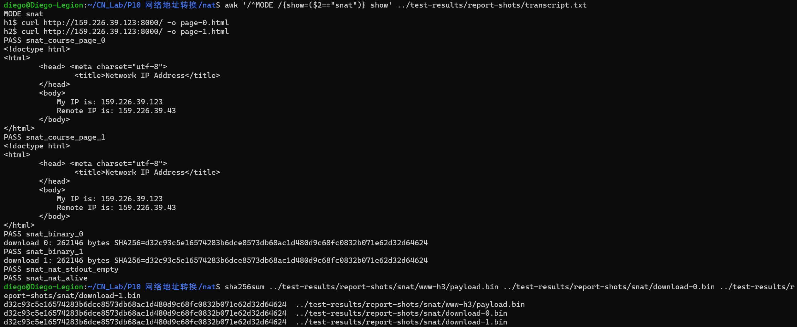

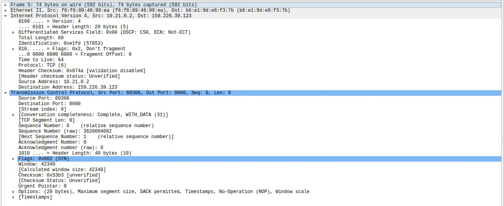

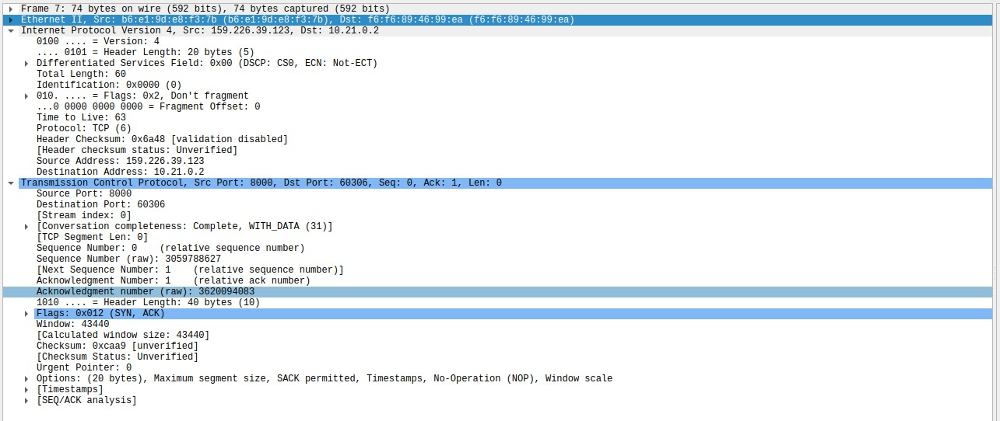

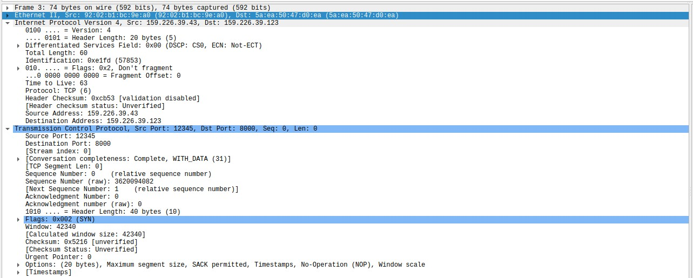

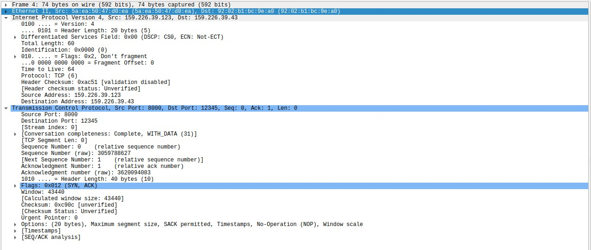

### 5.3 DNAT结果

| h3访问地址 | 页面本机IP | 页面远端IP | 下载字节数 | SHA256前16位 |
| --- | --- | --- | --- | --- |
| 159.226.39.43:8000 | 10.21.0.1 | 159.226.39.123 | 262146 | eb427f5ea92eacdd |
| 159.226.39.43:8001 | 10.21.0.2 | 159.226.39.123 | 262146 | 43034863af41d98e |

两个页面与预期的完整内容相同，两个二进制文件也分别与对应的服务器源文件一致，这表明不同的外部端口都被正确地分发到了h1与h2。

下面的Wireshark截图显示，目的地址159.226.39.43:8000被改为10.21.0.1:8000，而客户端的源地址与端口保持不变；内部服务器回包的源地址则由10.21.0.1恢复为159.226.39.43，源端口保持8000，客户端始终同最初访问的那个外部服务地址通信。

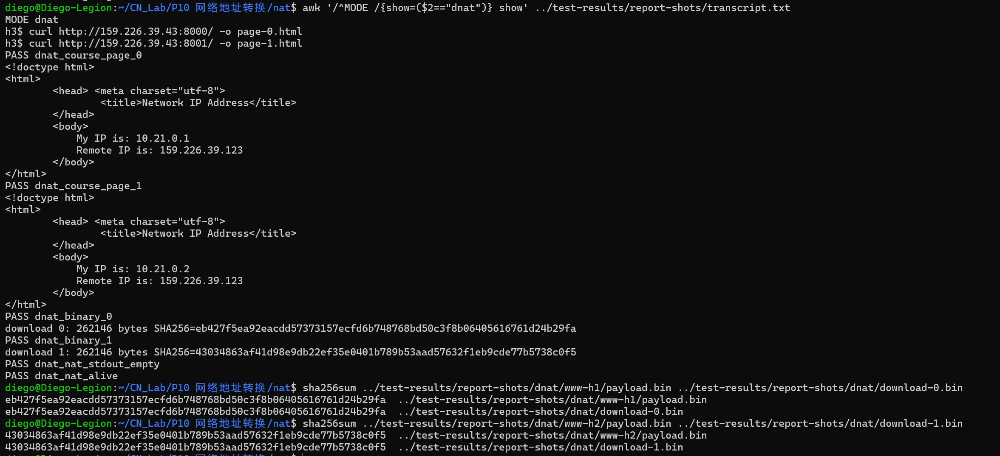

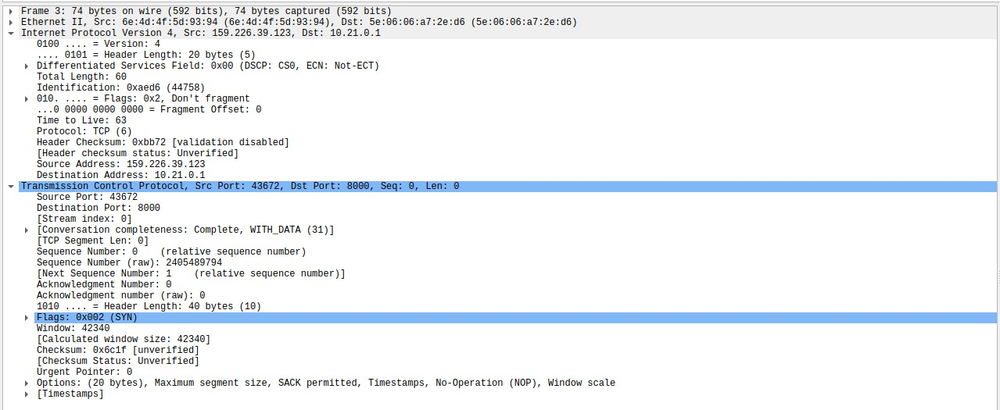

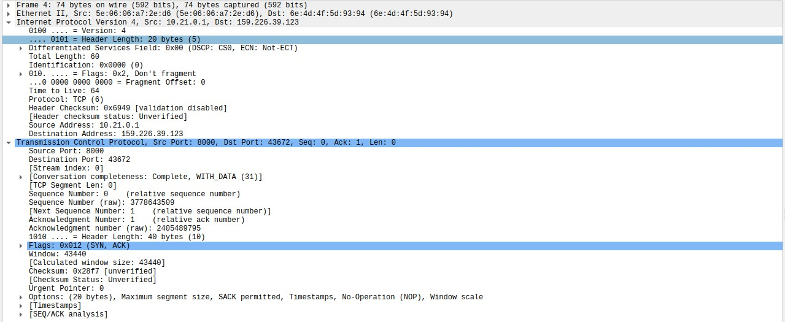

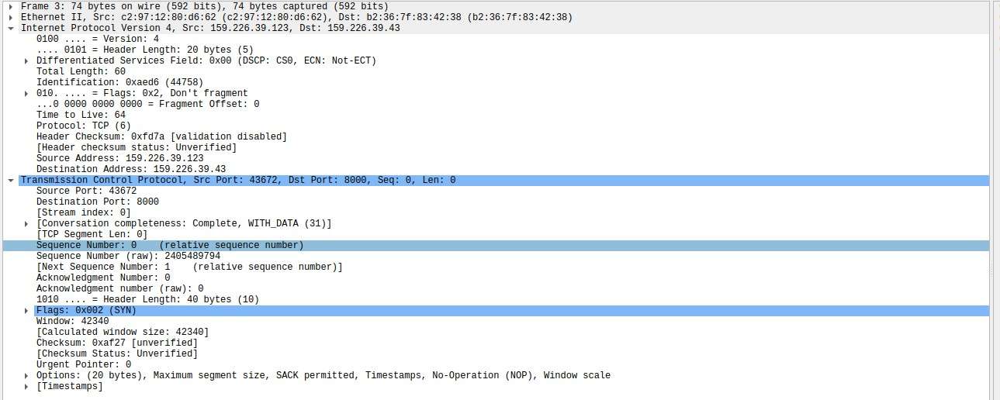

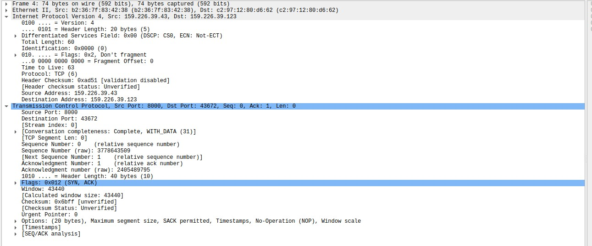

### 5.4 串联NAT结果

h1访问192.0.2.2:8000之后，h2页面上显示的本机IP为10.22.0.2，远端IP为192.0.2.1。二进制文件下载了262146字节，逐字节比较通过，SHA256的前16位为aba7f60cf00c20c1。

本轮去程地址变化情况如下：

```text
h1发出：10.21.0.1:42690 -> 192.0.2.2:8000
n1之后：192.0.2.1:12345 -> 192.0.2.2:8000
n2之后：192.0.2.1:12345 -> 10.22.0.2:8000
```

返回的报文先由n2把源服务地址恢复出来，再由n1把内部客户端的目的地址恢复出来。

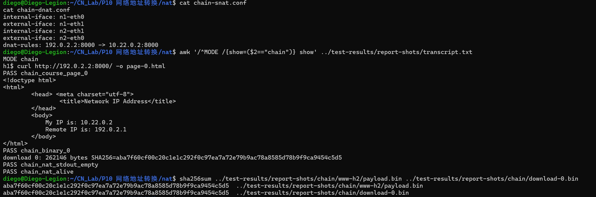

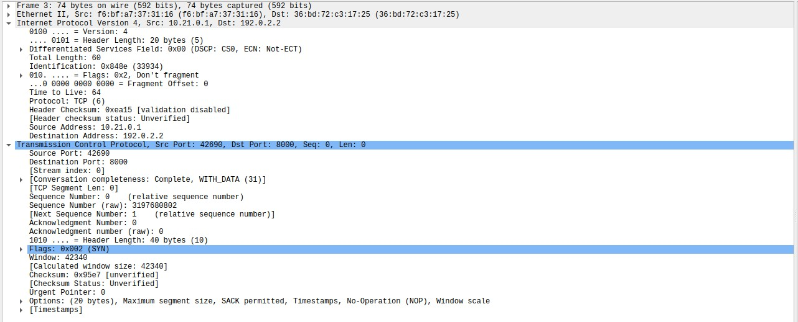

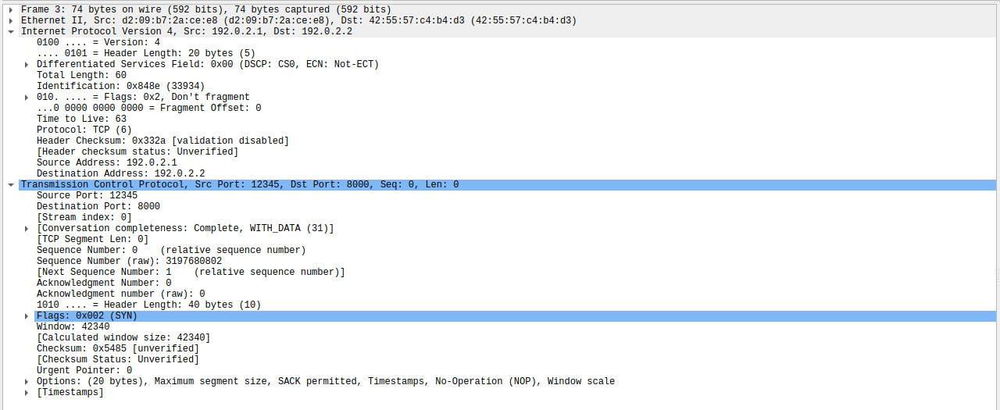

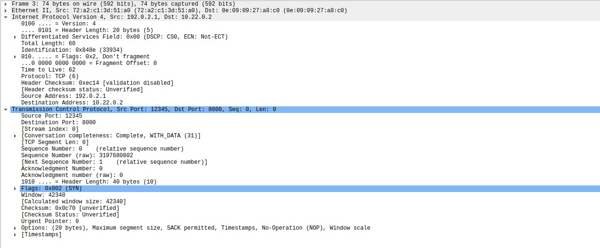

### 5.5 报文与连接状态核对

以只读方式分析了三种拓扑的八份接口PCAP，其中共有3756条捕获到的TCP记录，IP与TCP校验和均有效。又通过相同的SYN序号把内外接口上的报文配对，核对了地址与端口的转换，以及每一个NAT的TTL减1。

此外还使用独立的本地状态机测试，覆盖了SYN重传复用、多客户端与远端端口的隔离、非法入站、端口池耗尽、RST回收、DNAT返回端口与静态端口保留、FIN/ACK以及32位序号回绕等情形。

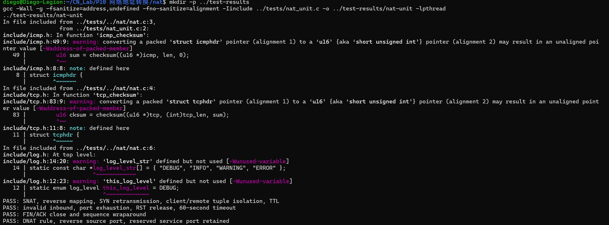

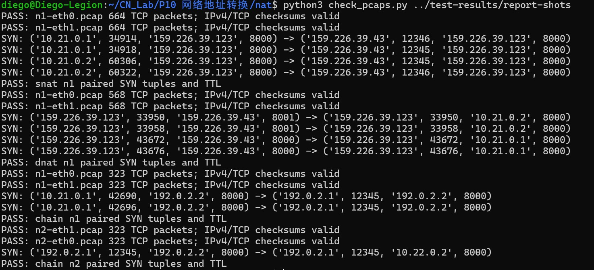

### 5.6 OJ结果


## 6 调试与实现分析

### 6.1 连接查找不能只依赖远端地址

两个内网客户端访问同一个h3服务的时候，远端的IP与端口是完全相同的。如果直接把这组信息当作唯一的映射键，外部端口与回包目的就会被串用。实现当中只用远端二元组来选择桶，桶内再按方向检查内部或者外部二元组；本地的并发下载与单元测试则分别核对了多客户端之间、以及同一客户端访问不同远端端口时的隔离情况。

### 6.2 改写IP也会影响TCP校验和

检查框架的TCP伪首部累加时发现，如果把两个32位地址连同其余字段直接累加到32位变量上，最高位的进位就有可能丢失。实现改为按64位累计，再回卷到16位之后参与TCP数据的求和，从而避免依赖特定地址恰好不发生溢出。

### 6.3 动态映射与静态规则生命周期不同

SNAT映射消失的时候需要把动态端口归还；而DNAT的一条连接结束时，只能删除该连接对应的映射，不能把静态规则所保留的端口释放掉。实现当中为映射增加了动态端口的标记，并在单元测试中确认：收到DNAT连接的RST之后，规则端口仍然被保留着。FIN回收则要等待双向确认，而不是看到单边FIN就立刻删除，否则后续的确认报文可能无法完成转换。

## 7 实验结论

本实验对路由与NAT之间的分工有了更清楚的认识：路由负责选择出口与下一跳，ARP负责解析当前链路的MAC，NAT则在转发之前改变IP与端口，并维护返回路径所需的映射。SNAT与DNAT之所以能够串联，是因为每一台设备都按照各自的地址空间完成了双向转换。
