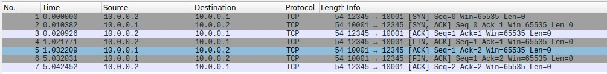
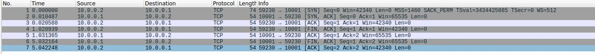
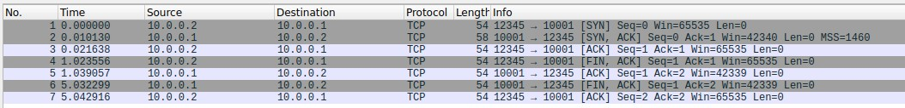
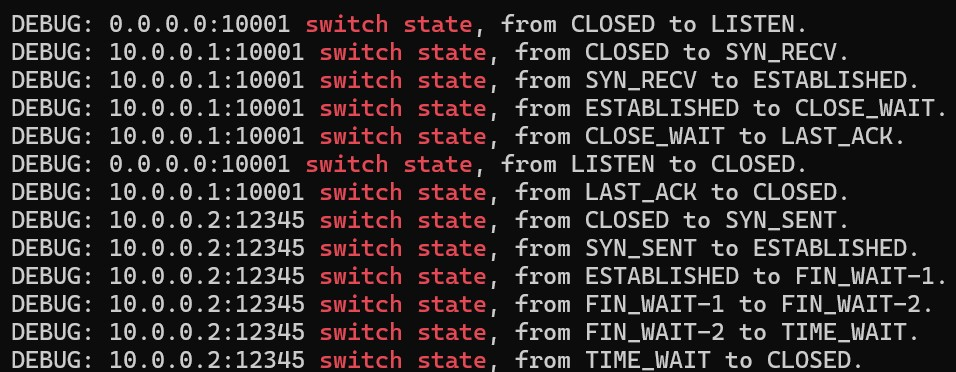
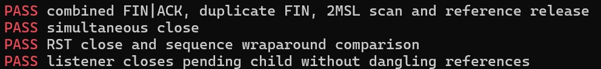

# 网络传输机制实验一报告

张晨轩 2024K8009929011

## 1 实验题目与目的

本实验是以给定的用户态网络协议栈为基础的，在其中实现TCP连接的建立与关闭，并在两台主机直接相连、链路不丢包的环境当中加以验证。除了让两端都运行本实验的程序之外，还分别在服务端与客户端上使用Python参考程序，通过抓包与状态日志来检查三次握手、连接关闭以及TIME_WAIT回收是否正确。

## 2 实验原理

### 2.1 三次握手

TCP是通过由源IP、源端口、目的IP与目的端口所组成的四元组来区分连接的。服务端先绑定本地端口并进入LISTEN状态，客户端则选取一个临时端口，然后主动发送SYN。如果客户端与服务端的初始序号分别为x和y，握手的整个过程如下：

```text
客户端 → 服务端：SYN，seq=x
服务端 → 客户端：SYN|ACK，seq=y，ack=x+1
客户端 → 服务端：ACK，seq=x+1，ack=y+1
```

SYN会占用一个序号，而纯ACK并不占用序号。服务端在收到SYN之后，会创建一个子Socket并把它放入半连接队列；等到客户端发出收尾的那个有效ACK之后，再把它移入accept队列，并唤醒正在等待的应用线程。监听Socket仍然负责接收新的请求，具体的连接则由子Socket来维护。

### 2.2 连接关闭

TCP是一个全双工协议，两个方向需要分别关闭。主动关闭的一端在发送FIN之后进入FIN_WAIT_1，收到确认之后再进入FIN_WAIT_2；等到对端也发来FIN，便回复ACK并进入TIME_WAIT。被动关闭的一端在收到FIN之后进入CLOSE_WAIT，等到本端应用调用close时再发送本端的FIN并进入LAST_ACK，确认到达之后最终转为CLOSED。

FIN同样会占用一个序号。在实际通信当中，ACK与FIN有可能合并在同一个报文里，所以程序会先更新确认信息，然后再处理FIN，使这种情况下的状态迁移也能顺利完成。主动关闭的一端之所以保留TIME_WAIT，是为了在需要的时候再次确认对端的FIN，同时也让旧的报文在连接释放之前有时间消失。

### 2.3 Socket组织与线程同步

程序分别维护着绑定表、监听表与连接表。绑定表记录的是端口是否已经被占用，监听表按本地端口查找，连接表则按完整的四元组查找。应用线程、收包线程与定时器线程都会访问这些结构，所以要用同一把锁来保护状态与链表；connect与accept会在等待通知之前把锁释放掉，醒来之后再检查条件，以免应用在等待期间阻塞收包处理。

应用调用close的时候，连接的后续报文有可能还没有处理完，因此Socket不能立即释放。程序通过引用计数来记录应用、哈希表以及TIME_WAIT定时器对Socket的使用情况，等到引用全部归还之后再释放缓冲区与等待对象。尚未被accept取出的子Socket，其初始引用由父Socket的队列持有。

## 3 程序实现

### 3.1 主动建连

下面给出的是 `tcp_sock_connect` 的完整实现。该函数会根据目的路由选择源IP，分配好本地端口之后，先把Socket加入连接表，然后再发送SYN。应用线程随后进入等待，等握手完成之后由收包线程把它唤醒。

```c
int tcp_sock_connect(struct tcp_sock *tsk, struct sock_addr *skaddr){
	pthread_mutex_lock(&tcp_lock);
	rt_entry_t *route = longest_prefix_match(ntohl(skaddr->ip));
	if(!route || tcp_sock_set_sport(tsk, 0)<0){
		pthread_mutex_unlock(&tcp_lock); return -1;
	}
	tsk->sk_sip = route->iface->ip;
	tsk->sk_dip = ntohl(skaddr->ip);
	tsk->sk_dport = ntohs(skaddr->port);
	tsk->iss = tcp_new_iss();
	tsk->snd_una = tsk->snd_nxt = tsk->iss;
	tcp_set_state(tsk, TCP_SYN_SENT);
	tcp_hash(tsk);
	tcp_send_control_packet(tsk, TCP_SYN);
	while(tsk->state == TCP_SYN_SENT){
		pthread_mutex_unlock(&tcp_lock);
		sleep_on(tsk->wait_connect);
		pthread_mutex_lock(&tcp_lock);
	}
	int result = tsk->state==TCP_ESTABLISHED ? 0 : -1;
	pthread_mutex_unlock(&tcp_lock);
	return result;
}
```

### 3.2 主动和被动关闭

下面给出的是 `tcp_sock_close` 的完整实现。该函数依据当前状态决定是发送FIN还是清理连接。发送FIN之后，应用会把本端的引用归还，后续的ACK与FIN仍然由协议栈处理；如果关闭的是监听Socket，还要把队列中尚未交给应用的子Socket清理掉。

```c
void tcp_sock_close(struct tcp_sock *tsk){
	if(!tsk){ return; }
	pthread_mutex_lock(&tcp_lock);
	if(tsk->state==TCP_ESTABLISHED || tsk->state==TCP_SYN_RECV){
		tcp_set_state(tsk, TCP_FIN_WAIT_1);
		tcp_send_control_packet(tsk, TCP_FIN|TCP_ACK);
	}
	else if(tsk->state == TCP_CLOSE_WAIT){
		tcp_set_state(tsk, TCP_LAST_ACK);
		tcp_send_control_packet(tsk, TCP_FIN|TCP_ACK);
	}
	else if(tsk->state==TCP_LISTEN || tsk->state==TCP_SYN_SENT || tsk->state==TCP_CLOSED){
		struct tcp_sock *child, *next;
		list_for_each_entry_safe(child, next, &tsk->listen_queue, list){ tcp_finish(child); }
		list_for_each_entry_safe(child, next, &tsk->accept_queue, list){ tcp_finish(child); }
		tcp_finish(tsk);
	}
	free_tcp_sock(tsk);
	pthread_mutex_unlock(&tcp_lock);
}
```

### 3.3 TIME_WAIT回收

TIME_WAIT定时器在加入链表的时候会增加一次Socket引用。扫描发现它已经到期之后，先把定时器从链表中摘除，再清理连接表与绑定表，最终把定时器所持有的引用归还。下面给出的是 `tcp_scan_timer_list` 的完整实现。

```c
void tcp_scan_timer_list(){
	pthread_mutex_lock(&tcp_lock);
	struct tcp_timer *timer, *next;
	list_for_each_entry_safe(timer, next, &timer_list, list){
		timer->timeout -= TCP_TIMER_SCAN_INTERVAL;
		if(timer->timeout <= 0){
			struct tcp_sock *tsk = timewait_to_tcp_sock(timer);
			list_delete_entry(&timer->list); init_list_head(&timer->list);
			timer->enable = 0;
			tcp_finish(tsk);
			free_tcp_sock(tsk);
		}
	}
	pthread_mutex_unlock(&tcp_lock);
}
```

接收处理在 `tcp_in.c` 当中按当前状态分别进行：建连的时候检查SYN与ACK之间的关系，并把完成握手的子Socket移入accept队列；关闭的时候则处理FIN_WAIT_1、FIN_WAIT_2、CLOSING、LAST_ACK与TIME_WAIT等状态。

## 4 实验流程与结果

### 4.1 编译与本地测试

在 `tcp_stack/` 目录当中，使用原始的Makefile执行下面的命令：

```bash
make
sudo python3 lab_test.py --output ../test-results/verified
```

输出的内容如下：

```
cc h1$ /mnt/c/Users/30130/desktop/CN_Lab/P11 网络传输机制1/tcp_stack/tcp_stack server 10001
cc h2$ /mnt/c/Users/30130/desktop/CN_Lab/P11 网络传输机制1/tcp_stack/tcp_stack client 10.0.0.1 10001
PASS cc: handshake, two FINs/ACKs, no RST, checksums, lifecycle, empty C stdout
  {'src': '10.0.0.2', 'sport': 12345, 'dport': 10001, 'seq': 1947608056, 'ack': 0, 'flags': 2}
  {'src': '10.0.0.1', 'sport': 10001, 'dport': 12345, 'seq': 1805076468, 'ack': 1947608057, 'flags': 18}
  {'src': '10.0.0.2', 'sport': 12345, 'dport': 10001, 'seq': 1947608057, 'ack': 1805076469, 'flags': 16}
  {'src': '10.0.0.2', 'sport': 12345, 'dport': 10001, 'seq': 1947608057, 'ack': 1805076469, 'flags': 17}
  {'src': '10.0.0.1', 'sport': 10001, 'dport': 12345, 'seq': 1805076469, 'ack': 1947608058, 'flags': 16}
  {'src': '10.0.0.1', 'sport': 10001, 'dport': 12345, 'seq': 1805076469, 'ack': 1947608058, 'flags': 17}
  {'src': '10.0.0.2', 'sport': 12345, 'dport': 10001, 'seq': 1947608058, 'ack': 1805076470, 'flags': 16}
cp h1$ /mnt/c/Users/30130/desktop/CN_Lab/P11 网络传输机制1/tcp_stack/tcp_stack server 10001
cp h2$ python3 /mnt/c/Users/30130/desktop/CN_Lab/P11 网络传输机制1/tcp_stack/tcp_stack_conn.py client 10.0.0.1 10001
PASS cp: handshake, two FINs/ACKs, no RST, checksums, lifecycle, empty C stdout
  {'src': '10.0.0.2', 'sport': 59230, 'dport': 10001, 'seq': 750984111, 'ack': 0, 'flags': 2}
  {'src': '10.0.0.1', 'sport': 10001, 'dport': 59230, 'seq': 1705340565, 'ack': 750984112, 'flags': 18}
  {'src': '10.0.0.2', 'sport': 59230, 'dport': 10001, 'seq': 750984112, 'ack': 1705340566, 'flags': 16}
  {'src': '10.0.0.2', 'sport': 59230, 'dport': 10001, 'seq': 750984112, 'ack': 1705340566, 'flags': 17}
  {'src': '10.0.0.1', 'sport': 10001, 'dport': 59230, 'seq': 1705340566, 'ack': 750984113, 'flags': 16}
  {'src': '10.0.0.1', 'sport': 10001, 'dport': 59230, 'seq': 1705340566, 'ack': 750984113, 'flags': 17}
  {'src': '10.0.0.2', 'sport': 59230, 'dport': 10001, 'seq': 750984113, 'ack': 1705340567, 'flags': 16}
pc h1$ python3 /mnt/c/Users/30130/desktop/CN_Lab/P11 网络传输机制1/tcp_stack/tcp_stack_conn.py server 10001
pc h2$ /mnt/c/Users/30130/desktop/CN_Lab/P11 网络传输机制1/tcp_stack/tcp_stack client 10.0.0.1 10001
PASS pc: handshake, two FINs/ACKs, no RST, checksums, lifecycle, empty C stdout
  {'src': '10.0.0.2', 'sport': 12345, 'dport': 10001, 'seq': 633861512, 'ack': 0, 'flags': 2}
  {'src': '10.0.0.1', 'sport': 10001, 'dport': 12345, 'seq': 135224459, 'ack': 633861513, 'flags': 18}
  {'src': '10.0.0.2', 'sport': 12345, 'dport': 10001, 'seq': 633861513, 'ack': 135224460, 'flags': 16}
  {'src': '10.0.0.2', 'sport': 12345, 'dport': 10001, 'seq': 633861513, 'ack': 135224460, 'flags': 17}
  {'src': '10.0.0.1', 'sport': 10001, 'dport': 12345, 'seq': 135224460, 'ack': 633861514, 'flags': 16}
  {'src': '10.0.0.1', 'sport': 10001, 'dport': 12345, 'seq': 135224460, 'ack': 633861514, 'flags': 17}
  {'src': '10.0.0.2', 'sport': 12345, 'dport': 10001, 'seq': 633861514, 'ack': 135224461, 'flags': 16}
3/3 scenarios passed
```

### 4.2 C服务端与C客户端

两端都运行本实验的C程序。抓包中先出现SYN、SYN|ACK与ACK，说明三次握手已经完成；随后客户端主动发送FIN，服务端确认之后进入CLOSE_WAIT，等到本端应用调用close时才发送本端的FIN，最终由客户端回复ACK。本轮一共捕获到7条TCP记录，其中2条包含FIN，没有出现RST。



### 4.3 C服务端与Python客户端

h1运行C服务端，h2则用Python3运行下发的 `tcp_stack_conn.py` 客户端。本轮同样捕获到7条TCP记录，握手过程与双方FIN的确认关系都是正确的。C端由SYN_RECV进入ESTABLISHED，收到客户端的FIN之后进入CLOSE_WAIT，应用关闭之后再经过LAST_ACK进入CLOSED。这说明本实验的被动建连与关闭处理能够同系统的TCP互通。



### 4.4 Python服务端与C客户端

h1运行Python参考服务端，h2运行C客户端。C端能够向系统的TCP发起握手，并在连接建立之后主动关闭。本轮捕获到7条TCP记录，两个FIN都获得了确认，也没有出现异常的RST；客户端在回复收尾的那个ACK之后进入TIME_WAIT，随后由定时器把它转为CLOSED。



### 4.5 状态迁移与结果汇总

| 本地场景 | 服务端 | 客户端 | TCP捕获记录 | FIN记录 | 检查结果 |
| --- | --- | --- | --- | --- | --- |
| cc | C | C | 7 | 2 | 通过 |
| cp | C | Python | 7 | 2 | 通过 |
| pc | Python | C | 7 | 2 | 通过 |

三组测试当中SYN、SYN|ACK与ACK的序号关系都是正确的，双方的FIN都得到确认，IPv4与TCP校验和的检查也全部通过。检查的时候C程序仍然在运行，标准输出为空。主动关闭的C端日志依次出现FIN_WAIT_1、FIN_WAIT_2、TIME_WAIT与CLOSED，与抓包中所记录的关闭过程相符。



### 4.6 补充状态测试

在三组真实互通之外，还另外构造了控制报文，用以检查合并的FIN|ACK、重复的FIN、双方同时关闭、RST、序号回绕的比较，以及关闭监听Socket时对尚未accept的子连接所做的清理。这些测试用于核对正常运行过程当中不一定出现的状态分支。



### 4.7 OJ测试


## 5 调试与结果分析

### 5.1 Socket释放与连接结束的时机

应用线程结束对Socket的使用之后，连接表与定时器有可能还需要继续访问这个Socket。如果在发送FIN之后就把它释放，后续的ACK查表或者定时器扫描就有可能访问到已经释放的内存。因此这里用引用计数分别记录各处的使用情况，并在统一的清理函数中保留一份临时引用，等到父队列、连接表与绑定表都清理完毕之后再归还。

### 5.2 合并报文与关闭状态迁移

同一个报文有可能既确认本端的FIN，又携带了对端的FIN。如果只按照进入函数时的状态处理一次，就有可能漏掉其中的一项操作。因此这里先处理ACK，再根据更新之后的状态去处理FIN；当双方同时关闭的时候，则通过CLOSING状态等待本端的FIN得到确认。

## 6 实验结论与体会

本实验完成了无丢包环境下的TCP连接建立与关闭，并在两端均运行C程序、以及分别用Python参考程序替换一端的情况下，使握手、FIN确认与状态迁移都与预期一致。主动关闭的一端能够在TIME_WAIT结束之后释放连接，补充测试也覆盖了合并报文、同时关闭以及部分资源回收的边界情况。

此前使用Socket的时候，连接的建立与关闭主要由系统来完成；而这次需要自行维护四元组、序号、等待通知以及Socket的生命周期，对这些接口背后的处理过程也就有了更为具体的认识。与前面的NAT实验联系起来看，NAT维护的是转发过程当中的地址与端口映射，本实验则进一步实现了通信端点自身的连接状态。握手与挥手的关键，在于结合当前状态去判断每个控制报文的含义，而不只是按顺序把几个报文发出去。
