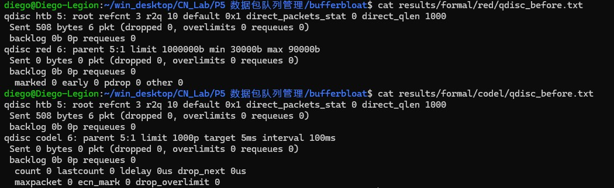
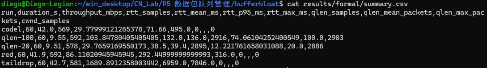
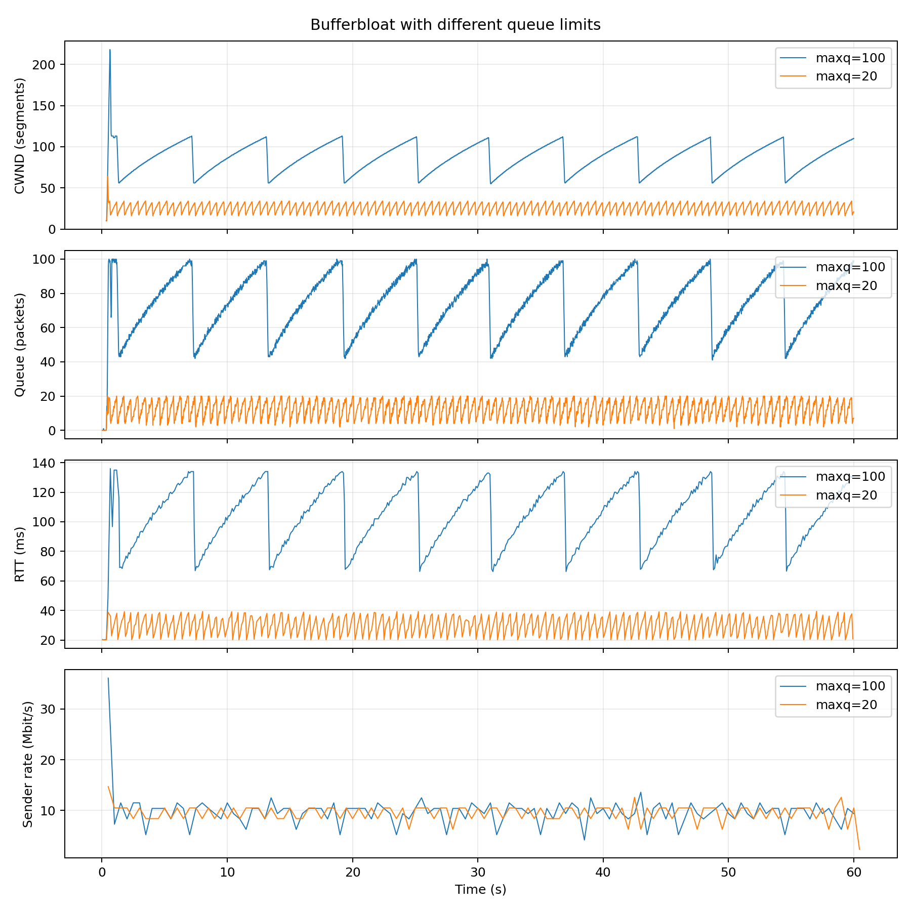
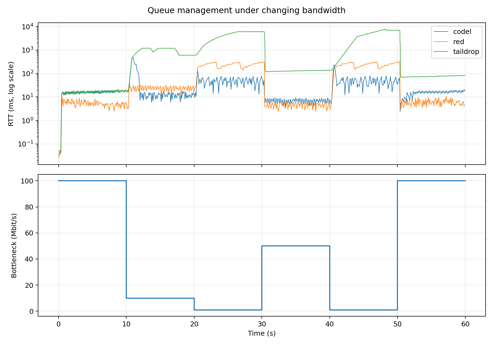

# 数据包队列管理实验报告

张晨轩 2024K8009929011

## 1 实验题目

本实验在Mininet环境下对Bufferbloat现象进行了复现，考察队列大小对TCP吞吐率、拥塞窗口和往返时延所产生的影响，并对Tail Drop、RED与CoDel在动态带宽条件下的表现加以比较。

## 2 实验目的

1. 理解数据包队列对突发流量所起的缓冲作用，并理解队列过大导致时延上升的原因。
2. 同步采集发送方的拥塞窗口、瓶颈队列长度、RTT和吞吐率，并对各指标之间的关系加以分析。
3. 使用Linux TC完成不同队列管理算法的配置，在相同的带宽变化过程中对延迟与吞吐率进行比较。

## 3 实验原理

### 3.1 队列大小与Bufferbloat

当数据的到达速率高于出口的发送速率的时候，那些暂时无法发送出去的数据包就需要进入队列之中等待。队列若设置得过小，在突发流量期间就容易出现丢包；队列若设置得过大，又会把积压下来的数据保存较长的时间。对于长度为Q字节、发送速率为C字节每秒的队列而言，其排队时间可以近似表示为Q/C。

TCP Reno在收到确认报文之后会逐渐增大拥塞窗口，而拥塞的判定主要依据丢包。当Tail Drop队列尚未填满时，继续增大发送窗口可能只会增加排队的数据量，并不能提高已经受到瓶颈限制的吞吐率。Bufferbloat中“传输速率较高，但交互延迟很大”的现象，其原因即在于此。

### 3.2 队列管理算法

Tail Drop采用先进先出的队列，在队列填满之后丢弃新到达的数据包。该方式的实现较为简单，但在反馈拥塞时，队列中通常已经存在较多的积压。

RED依据平均队列长度决定提前丢包的概率。平均长度低于最小阈值时正常接收；处于两个阈值之间时按概率丢包；高于最大阈值时则加强丢弃。该算法能够提前向发送方反馈拥塞，但对阈值等参数较为敏感。

CoDel关注的是数据包在队列中的停留时间。在一个观察周期内，若最小停留时间持续高于目标值，即进入丢弃状态，从而对持续的积压加以抑制。本实验采用的target为5ms，interval为100ms。

### 3.3 TCP-Incast

TCP-Incast通常出现在多个服务器同时向同一个接收端返回数据的情形之中，例如并行查询或者分布式存储的读取过程。多路流量汇聚到同一条出口链路上之后，瞬时到达速率会超过该链路的发送能力，有限的交换机缓冲区很快被填满，于是造成集中的丢包。发送端随后会缩小拥塞窗口；若丢包无法通过快速重传得到恢复，还要继续等待重传超时。在低时延的网络之中，这段等待有可能远远长于正常的RTT；倘若应用又必须等待所有服务器都返回结果，那么少数连接的超时就会拖慢整个请求，使有效吞吐率出现明显的下降。

TCP-Incast与Bufferbloat都与瓶颈处的流量积压有关，但两者所关注的问题并不相同：一是多对一的同步突发流量所导致的丢包、重传超时与吞吐率下降，二是过大的缓冲区长期保存积压数据所导致的高排队时延。因此，单纯增大缓冲区并不是通用的解决办法。

## 4 实验流程

### 4.1 运行环境

```bash
uname -r
python3 --version
mn --version
iperf --version
```

运行所得结果如下：

```bash
6.6.87.2-microsoft-standard-WSL2
Python 3.12.3
2.3.0
iperf version 2.1.9 (14 March 2023) pthreads
```

### 4.2 复现Bufferbloat

两条链路的单向延迟均为5ms，因此在无明显排队的情况下，RTT约为20ms。r1到h2的带宽为10Mbit/s，队列上限分别设为20包与100包，每组持续60秒，其余条件保持一致。

```bash
sudo python3 reproduce_bufferbloat.py --maxq 20 --duration 60 --output results/formal/qlen-20
sudo python3 reproduce_bufferbloat.py --maxq 100 --duration 60 --output results/formal/qlen-100
```

对两组的cwnd、qlen、RTT和发送速率曲线进行比较，考察队列上限增大是否主要带来时延的增加，以及吞吐率是否随之提高。

### 4.3 比较队列管理算法

两条链路的初始带宽均为100Mbit/s，本部分不额外配置传播延迟。运行时间同样保持为60秒，并按每10秒划分为一个阶段，将瓶颈带宽依次设置为100、10、1、50、1、100Mbit/s。

| 时间区间/s | 0—10 | 10—20 | 20—30 | 30—40 | 40—50 | 50—60 |
| --- | ---: | ---: | ---: | ---: | ---: | ---: |
| 瓶颈带宽/Mbit/s | 100 | 10 | 1 | 50 | 1 | 100 |

Tail Drop使用1000包的pfifo队列；RED的limit为1000000字节、min为30000字节、max为90000字节、avpkt为1000字节、burst为55，最大概率为0.1；CoDel的limit为1000包、target为5ms、interval为100ms。

```bash
sudo python3 mitigate_bufferbloat.py --algo taildrop --duration 60 --output results/formal/taildrop
sudo python3 mitigate_bufferbloat.py --algo red --duration 60 --output results/formal/red
sudo python3 mitigate_bufferbloat.py --algo codel --duration 60 --output results/formal/codel
```



### 4.4 统计与绘图

```bash
python3 analyze_results.py --results results/formal
cat results/formal/summary.csv
```



## 5 实验结果及分析

### 5.1 队列大小的影响

两组实验的实测统计结果如下表所示，其中RTT的单位为ms，队列长度的单位为包。统计值取自60秒的观测窗口；吞吐率采用iperf服务端记录的接收汇总。

| 队列上限/包 | 接收吞吐率/Mbit/s | RTT均值/ms | RTT P95/ms | RTT最大值/ms | 平均队列长度/包 | 最大队列长度/包 |
| --- | ---: | ---: | ---: | ---: | ---: | ---: |
| 20 | 9.51 | 29.77 | 38.50 | 39.40 | 12.22 | 20 |
| 100 | 9.55 | 103.85 | 132.00 | 136.00 | 74.06 | 100 |

两组的接收吞吐率均接近10Mbit/s的瓶颈，队列增大之后仅提高约0.42%，而RTT均值增至约3.49倍。100包组的窗口和队列曲线呈现明显的锯齿形态：Reno逐渐增大窗口，队列积压与RTT随之增加，出现丢包后窗口回落，队列再逐步重新增长。20包组也存在类似的周期，但积压规模与RTT波动范围均明显较小。

这说明在本轮单流实验中，20包队列已能较为充分地利用链路，继续增大队列主要带来的是延迟的增加。

netem同时模拟传播延迟与队列限制，因此观察到的积压包数中也包含尚未到达发送时间的数据包，不能将所有qlen样本直接等同于额外的排队时间。



### 5.2 动态带宽下的算法比较

三种算法采用相同的带宽时间线，实测结果如下表所示：

| 算法 | 接收吞吐率/Mbit/s | RTT均值/ms | RTT P95/ms | RTT最大值/ms |
| --- | ---: | ---: | ---: | ---: |
| Tail Drop | 42.70 | 1689.89 | 6959.00 | 7846.00 |
| RED | 41.90 | 86.11 | 292.45 | 316.00 |
| CoDel | 42.00 | 29.78 | 71.66 | 495.00 |

当带宽降至1Mbit/s时，Tail Drop允许较多数据留在队列之中，RTT达到数秒。RED通过提前丢包对积压加以抑制，CoDel则进一步降低持续排队时延。相对于Tail Drop，RED和CoDel的平均RTT分别降低约94.90%和98.24%，而接收吞吐率分别降低约1.87%和1.64%。在本轮配置下，主动队列管理以较小的吞吐率差异换来了明显的时延改善。

CoDel的RTT均值与P95均为最低，但最大值495ms仍高于RED的316ms。曲线表明，CoDel在第一次带宽下降之后出现短时峰值，随后恢复，因此不能将“平均表现较好”理解为每个时刻的延迟都优于RED。RED在高速阶段也可能具有更低的RTT，但在1Mbit/s阶段，固定的字节阈值对应更长的排队时间，其持续延迟高于CoDel。

RTT纵轴采用对数坐标，使低时延算法的曲线不会被Tail Drop的高峰值所掩盖。带宽降低时，原有在途数据与队列中的积压不能立即消失，因此RTT可能先上升再恢复；带宽提高时，队列排空速度随之加快。



## 6 调试过程

### 6.1 监测文件与进程退出

检查下发代码时发现，cwnd与qlen的采样数据写入之后没有显式刷新，监测器又通过`terminate()`结束，位于缓冲区末尾的那一部分数据可能无法写入磁盘。按照常见问题材料给出的思路增加了`flush()`，同时通过停止事件使监测器正常退出并关闭文件。短时验证中各采样文件均非空，随后才进行60秒的正式测量。

### 6.2 队列与算法配置验证

原有的队列监测通过正则匹配输出中的第二个backlog，因而依赖于qdisc的排列顺序。完善后的程序改为读取TC的JSON结果并选取叶子队列，避免将HTB与子队列重复统计。20包组的实际采样达到20包上限，且结束后的netem统计显示丢包，说明采集的对象与所设置的队列一致。

RED参数补全之后，程序检查每条配置命令的返回码，并保存qdisc快照。CoDel快照明确包含`target 5ms interval 100ms`，RED快照包含对应的字节阈值。配置一旦失败即中止实验，避免将默认队列的结果误写为RED或CoDel的结果。

## 7 实验结论

本实验完成了Bufferbloat的复现以及三种队列管理机制的对照测试。通过同步采集cwnd、qlen、RTT和吞吐率，能够区分链路利用率与排队时延这两项性能指标，并可从带宽的变化过程中观察拥塞反馈与队列恢复情况。

在本轮实验中，队列上限由20包增至100包时，吞吐率基本不变，平均RTT却明显上升，验证了过大缓冲对延迟的负面影响。在动态带宽条件下，RED和CoDel均能有效降低Tail Drop下的长期积压；CoDel取得最低的平均RTT与P95，但仍存在带宽突变时的短时峰值。
