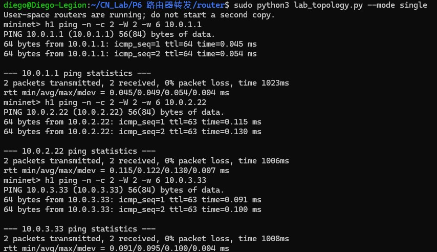
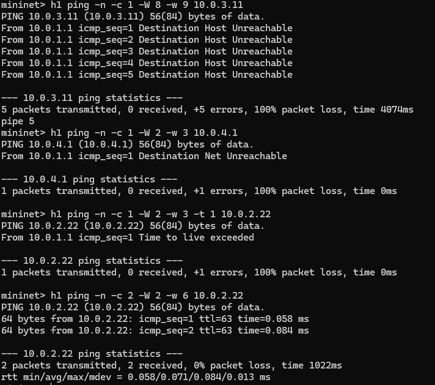
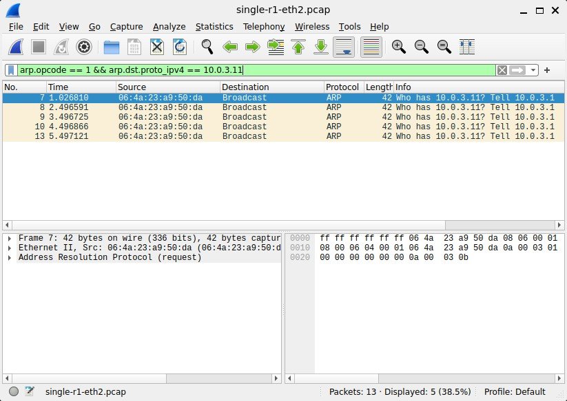
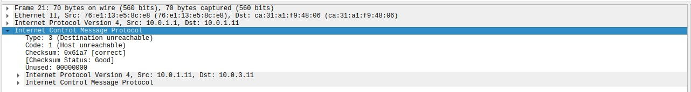
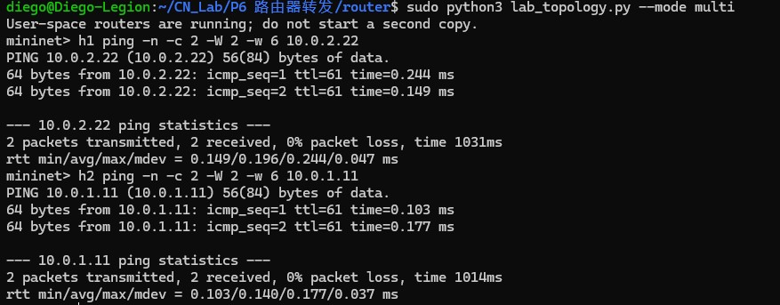
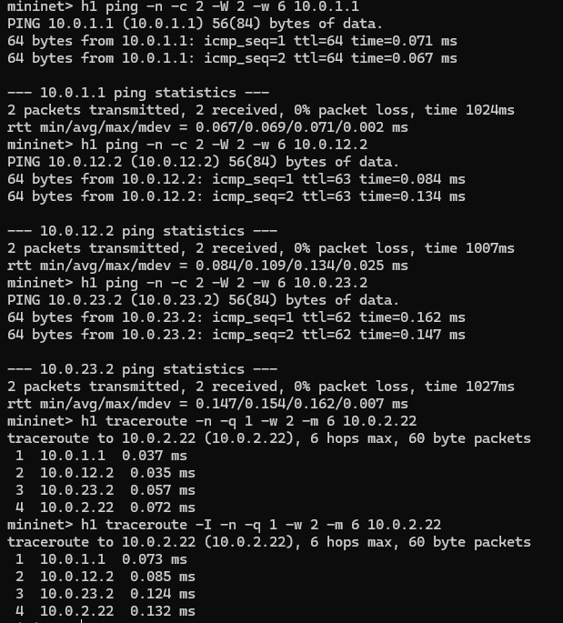

# 路由器转发实验报告

张晨轩 2024K8009929011

## 1 实验题目与目的

本实验以给定的用户态网络协议栈为基础，在其中实现IPv4路由转发、ARP解析与缓存管理，以及ICMP应答与错误反馈，并在单路由器拓扑与三跳拓扑中对实现结果加以验证。

## 2 实验原理

### 2.1 最长前缀匹配与下一跳

路由表中保存的是目的网络、掩码、网关与出口接口这几项内容。把目的IP与掩码做按位与运算之后，如果所得结果与该路由的网络前缀相同，就表示这条路由匹配成功；当多条路由同时匹配的时候，则选择掩码当中连续1最多的那一条。`0.0.0.0/0`能够匹配所有的目的地址，但其优先级低于任何一条更为具体的路由。

路由器并不需要预先知道通往服务器的完整路径，只需要把当前这一跳确定下来即可。直连路由的下一跳就是目的主机本身；非直连路由的下一跳则是路由表当中给出的网关。下一跳的MAC地址要靠ARP来解析，不能把远端服务器的IP直接交给本地的ARP去查询。

### 2.2 IP转发与Ethernet头重写

路由器在转发的时候会保留源IP与目的IP，把TTL减1并重新计算IP头的校验和，接着再把Ethernet的源MAC改为出口接口的MAC，目的MAC改为下一跳的MAC。由此可以看出，IP地址描述的是通信的端点，而MAC地址用于当前链路上的交付。TTL所限制的是报文最多还能被转发多少次，这样就能避免报文在路由环路当中一直循环下去。

发送给路由器本机接口的报文，与需要转发的报文是分开处理的。本机收到合法的ICMP Echo Request时，会构造出一个Echo Reply，并保留其中的标识符、序号以及全部回显数据；本机新生成的IP报文使用初始TTL，不再执行转发时那一步TTL减1。

### 2.3 ARP缓存与等待队列

ARP请求是以Ethernet广播的方式发送出去的，只有收到对应的应答之后，等待中的IP报文才能被封装并发送。程序维护着32项ARP缓存，映射的存活时间超过15秒便会失效；尚未完成解析的报文则按“出口接口与下一跳IP”归入等待队列，以免每一个报文都单独发起一次ARP请求。

首次请求会立即发送，此后大约每隔1秒重试一次，总共发送5次；若仍然没有应答，就对每一个等待中的报文返回主机不可达，并把相应的缓存释放掉。缓存表与等待队列都由互斥锁保护，而实际发送ARP或ICMP的操作被放在锁外完成，以免ICMP发送时再次访问ARP缓存而造成死锁。

### 2.4 ICMP反馈与traceroute

| 情况 | Type | Code | 含义 |
| --- | --- | --- | --- |
| 本机收到回显请求 | 0 | 0 | Echo Reply |
| 查不到目的网络路由 | 3 | 0 | 网络不可达 |
| 路由存在但ARP解析失败 | 3 | 1 | 主机不可达 |
| UDP探测到达无对应端口的本机 | 3 | 3 | 端口不可达 |
| 转发时TTL不大于1 | 11 | 0 | 传输途中TTL超时 |

ICMP错误报文会携带原来的IP头以及其后的8字节内容，有了这些信息，发送方就能识别出是哪一个原始报文触发了错误。程序同时避免了针对ICMP错误再次产生ICMP错误，从而防止错误反馈之间相互循环。

traceroute是通过逐步增加探测包TTL的方式来实现的。中间的路由器会返回超时信息，逐跳的地址由此被暴露出来；当探测到达终点的时候，普通的UDP模式通常会收到端口不可达，而ICMP模式收到的则是回显应答。

## 3 程序实现

### 3.1 最长前缀匹配

输入与路由项都采用主机字节序；对于合法的连续掩码而言，数值越大就代表前缀越长。`best`被初始化为空，这样默认路由就不会因为掩码为0而被漏掉。

```c
rt_entry_t *longest_prefix_match(u32 dst){
	rt_entry_t *entry, *best = NULL;

	/* 路由表与dst均使用主机字节序；合法连续掩码越大，前缀越长。 */
	list_for_each_entry(entry, &rtable, list){
		if((dst&entry->mask)!=(entry->dest&entry->mask) || entry->iface==NULL){
			continue;
		}
		/* best为空时也接受mask为0的默认路由，不能只比较mask>0。 */
		if(best==NULL || entry->mask>best->mask){
			best = entry;
		}
	}
	return best;
}
```

### 3.2 本机报文与转发处理

程序先检查报文长度与IP校验和，然后再判断该报文是否属于本机；转发分支则先处理TTL与无路由这两类错误，随后修改TTL、更新校验和，并交给ARP去发送。目的地址要与所有本机接口逐一比较，而不能只比较入口接口。

```c
void handle_ip_packet(iface_info_t *iface, char *packet, int len){
	(void)iface;
	/* 原始套接字可能收到短帧，先检查固定头部，再读取变长IPv4头。 */
	if(len < ETHER_HDR_SIZE+IP_BASE_HDR_SIZE){
		free(packet);
		return;
	}
	struct iphdr *ip = packet_to_ip_hdr(packet);
	int header_length = IP_HDR_SIZE(ip);
	int ip_length = ntohs(ip->tot_len);
	if(ip->version!=4 || header_length<IP_BASE_HDR_SIZE ||
		ip_length<header_length || ETHER_HDR_SIZE+ip_length>len ||
		ip->checksum!=ip_checksum(ip)){
		free(packet);
		return;
	}
	/* Ethernet可能含填充，后续处理只使用IP总长度声明的有效内容。 */
	len = ETHER_HDR_SIZE+ip_length;
	u32 destination = ntohl(ip->daddr);
	iface_info_t *local;
	list_for_each_entry(local, &instance->iface_list, list){
		/* 任一本机接口地址均属于路由器，不能只检查报文的入口地址。 */
		if(destination != local->ip){
			continue;
		}
		if((ntohs(ip->frag_off)&0x3fff) != 0){
			/* 本实验不实现发给本机的IPv4分片重组。 */
			free(packet);
			return;
		}
		int payload_length = ip_length-header_length;
		if(ip->protocol==IPPROTO_ICMP && payload_length>=ICMP_HDR_SIZE){
			struct icmphdr *icmp = (struct icmphdr *)IP_DATA(ip);
			if(icmp->type==ICMP_ECHOREQUEST && icmp->code==0 &&
				icmp->checksum==icmp_checksum(icmp, payload_length)){
				icmp_send_packet(packet, len, ICMP_ECHOREPLY, 0);
			}
		}
		else if(ip->protocol == IPPROTO_UDP){
			/* 支持UDP探测以本机为终点，返回端口不可达。 */
			icmp_send_packet(packet, len, ICMP_DEST_UNREACH, ICMP_PORT_UNREACH);
		}
		free(packet);
		return;
	}

	/* 在修改原包之前生成错误，ICMP引用部分保留接收时的IP头。 */
	if(ip->ttl <= 1){
		icmp_send_packet(packet, len, ICMP_TIME_EXCEEDED, ICMP_EXC_TTL);
		free(packet);
		return;
	}
	rt_entry_t *route = longest_prefix_match(destination);
	if(route == NULL){
		icmp_send_packet(packet, len, ICMP_DEST_UNREACH, ICMP_NET_UNREACH);
		free(packet);
		return;
	}
	ip->ttl -= 1;
	ip->checksum = ip_checksum(ip);
	u32 next_hop = route->gw ? route->gw : destination;
	/* 发送函数或ARP等待队列接管packet，调用后不能再次free。 */
	iface_send_packet_by_arp(route->iface, next_hop, packet, len);
}
```

### 3.3 ICMP封装

回显应答会复制完整的ICMP内容；错误报文则引用原来的IP头以及其后的至多8字节。需要先初始化IP头，再去计算ICMP头的位置，原因是`IP_DATA`依赖于`ihl`字段。返程的出口由通往原发送者的那条路由来决定。

```c
void icmp_send_packet(const char *in_pkt, int len, u8 type, u8 code){
	if(len < ETHER_HDR_SIZE+IP_BASE_HDR_SIZE){
		return;
	}
	struct iphdr *original = packet_to_ip_hdr(in_pkt);
	int header_length = IP_HDR_SIZE(original);
	int ip_length = ntohs(original->tot_len);
	if(header_length<IP_BASE_HDR_SIZE || ip_length<header_length ||
		ETHER_HDR_SIZE+ip_length>len){
		return;
	}
	int echo = type==ICMP_ECHOREPLY;
	if(!echo && !icmp_error_allowed(in_pkt, original, ip_length)){
		return;
	}
	u32 destination = ntohl(original->saddr);
	rt_entry_t *return_route = longest_prefix_match(destination);
	if(return_route == NULL){
		return;
	}
	int copy_length;
	if(echo){
		/* 回显应答保留标识符、序号和全部数据，而不只复制8字节。 */
		copy_length = ip_length-header_length;
		if(original->protocol!=IPPROTO_ICMP || copy_length<ICMP_HDR_SIZE){
			return;
		}
	}
	else{
		/* 错误报文引用原始变长IP头和随后至多8字节，不越过短包边界。 */
		int payload_length = ip_length-header_length;
		copy_length = header_length+(payload_length<ICMP_COPIED_DATA_LEN ? payload_length : ICMP_COPIED_DATA_LEN);
	}
	int icmp_length = echo ? copy_length : ICMP_HDR_SIZE+copy_length;
	int packet_length = ETHER_HDR_SIZE+IP_BASE_HDR_SIZE+icmp_length;
	char *packet = calloc(1, packet_length);
	if(packet == NULL){
		return;
	}
	struct iphdr *ip = packet_to_ip_hdr(packet);
	u32 source = echo ? ntohl(original->daddr) : return_route->iface->ip;
	ip_init_hdr(ip, source, destination, IP_BASE_HDR_SIZE+icmp_length, IPPROTO_ICMP);
	/* IP_DATA依赖ihl，必须先初始化IP头，才能得到ICMP头的正确位置。 */
	struct icmphdr *icmp = (struct icmphdr *)IP_DATA(ip);
	if(echo){
		memcpy(icmp, IP_DATA(original), copy_length);
	}
	else{
		memcpy((char *)icmp+ICMP_HDR_SIZE, original, copy_length);
	}
	icmp->type = type;
	icmp->code = code;
	icmp->checksum = icmp_checksum(icmp, icmp_length);
	/* ip_send_packet根据返程路由选出口，并经ARP发送或缓存新报文。 */
	ip_send_packet(packet, packet_length);
}
```

### 3.4 缓存并发与缓冲区管理

从ARP查找失败到报文入队这段时间里，ARP应答有可能已经到达，所以入队函数会在持有锁之后再次检查一遍缓存。插入映射的时候，先在锁内把待发的队列取出来，解锁之后再统一发送；老化线程同样先把失败队列取出，等到解锁之后再生成ICMP。

框架中的`iface_send_packet`会把传入的packet释放掉，所以转发函数交出报文之后不能再释放一次；报文加入ARP等待队列的时候，其生命周期由队列接管；而校验失败、无法转发或者本机处理已经结束的原始报文，则需要及时释放。

## 4 实验环境与拓扑

### 4.1 单路由器拓扑

```text
h1 —— r1 —— h2
       |
       h3
```

| 节点接口 | IPv4地址 | 主机默认网关 |
| --- | --- | --- |
| h1-eth0 | 10.0.1.11/24 | 10.0.1.1 |
| r1-eth0 | 10.0.1.1/24 | — |
| h2-eth0 | 10.0.2.22/24 | 10.0.2.1 |
| r1-eth1 | 10.0.2.1/24 | — |
| h3-eth0 | 10.0.3.33/24 | 10.0.3.1 |
| r1-eth2 | 10.0.3.1/24 | — |

### 4.2 三跳拓扑

```text
h1 —— r1 —— r2 —— r3 —— h2
```

| 链路 | 左端地址 | 右端地址 |
| --- | --- | --- |
| h1—r1 | 10.0.1.11/24 | 10.0.1.1/24 |
| r1—r2 | 10.0.12.1/24 | 10.0.12.2/24 |
| r2—r3 | 10.0.23.1/24 | 10.0.23.2/24 |
| r3—h2 | 10.0.2.1/24 | 10.0.2.22/24 |

各个接口按上表从左到右的顺序加入：r1的eth0连接h1、eth1连接r2；r2的eth0连接r1、eth1连接r3；r3的eth0连接r2、eth1连接h2。静态路由如下表所示，其中直连路由由接口配置自动生成：

| 节点 | 目的网络 | 下一跳 |
| --- | --- | --- |
| h1 | default | 10.0.1.1 |
| r1 | 10.0.2.0/24、10.0.23.0/24 | 10.0.12.2 |
| r2 | 10.0.1.0/24 | 10.0.12.1 |
| r2 | 10.0.2.0/24 | 10.0.23.2 |
| r3 | 10.0.1.0/24、10.0.12.0/24 | 10.0.23.1 |
| h2 | default | 10.0.2.1 |

## 5 实验流程与结果

### 5.1 编译与基础检查

在`router/`目录当中，使用原始的Makefile执行下面的命令：

```bash
make clean
make
sudo python3 run_tests.py --extended
```

最终输出的结果如下：

```
PASS
multi router processes alive, stdout empty: True

17/17 checks passed. Logs: /mnt/c/Users/30130/desktop/CN_Lab/P6 路由器转发/test-results/run-20261030-014759
```

测试全部通过。

### 5.2 单路由器连通性

| 源节点 | 目的地址 | 发送/接收 | 丢包率 | 应答TTL |
| --- | --- | --- | --- | --- |
| h1 | 10.0.1.1 | 2/2 | 0% | 64 |
| h1 | 10.0.2.22 | 2/2 | 0% | 63 |
| h1 | 10.0.3.33 | 2/2 | 0% | 63 |

访问r1的时候，回显应答由路由器本机生成，TTL为64；而访问h2或者h3的时候，应答要经过一次转发才能到达h1，TTL为63。



### 5.3 不可达与TTL超时反馈

```text
h1 ping -n -c 1 -W 8 -w 9 10.0.3.11
h1 ping -n -c 1 -W 2 -w 3 10.0.4.1
h1 ping -n -c 1 -W 2 -w 3 -t 1 10.0.2.22
```

| 测试 | 实际反馈 | 结果 |
| --- | --- | --- |
| 未知主机10.0.3.11 | From 10.0.1.1: Destination Host Unreachable | 符合预期 |
| 未知网络10.0.4.1 | From 10.0.1.1: Destination Net Unreachable | 符合预期 |
| TTL为1的跨网段探测 | From 10.0.1.1: Time to live exceeded | 符合预期 |
| ARP失败后再次ping h2 | 2次发送、2次接收、0%丢包 | 未出现持续阻塞 |

未知网络可以立即根据路由表判断出来；未知主机则要等到ARP请求失败，反馈的速度相对更慢。图4(a)当中针对10.0.3.11一共显示了5次ARP请求，第一个相邻间隔约为0.470秒，后面的三个间隔约为1秒；首个间隔偏短，与首次请求和周期线程的唤醒时机有关。ICMP则分别使用3/1、3/0和11/0。







### 5.4 三跳连通性与路径检查

在三跳拓扑上执行双向ping，并逐个访问各路由器的入口地址：

| 源节点 | 目的地址 | 发送/接收 | 丢包率 | 应答TTL |
| --- | --- | --- | --- | --- |
| h1 | 10.0.2.22 | 2/2 | 0% | 61 |
| h2 | 10.0.1.11 | 2/2 | 0% | 61 |
| h1 | 10.0.1.1 | 2/2 | 0% | 64 |
| h1 | 10.0.12.2 | 2/2 | 0% | 63 |
| h1 | 10.0.23.2 | 2/2 | 0% | 62 |

两端主机之间的应答要经过3台路由器，TTL由64变为61；而访问r1、r2、r3本机的时候，应答分别经历0、1、2次转发，与表中给出的64、63、62相符。



```text
h1 traceroute -n -q 1 -w 2 -m 6 10.0.2.22
h1 traceroute -I -n -q 1 -w 2 -m 6 10.0.2.22
```

两种探测方式得到的地址序列是一致的：

```text
1  10.0.1.1
2  10.0.12.2
3  10.0.23.2
4  10.0.2.22
```



### 5.5 OJ测试结果


## 6 问题定位与分析

### 6.1 ICMP头位置与初始化顺序

初次测试的时候，h1能够经过路由器ping通h2、h3，却ping不通路由器本机，未知网络与TTL错误也都没有反馈。转发能够成功，说明收包、查路由和ARP这几条链路基本可用，问题也就集中到了新生成的ICMP报文上。

检查之后发现，程序在初始化新IP头之前就使用了`IP_DATA(ip)`。该宏是依据`ihl`来计算负载起点的，而新分配的缓冲区里`ihl`还是0，结果ICMP被写到了IP头所在的位置。把顺序调整为先执行`ip_init_hdr`，再取得ICMP指针之后，本机应答与错误反馈都恢复了正常。这一现象说明，结构体指针的类型正确，并不保证它在报文中的偏移也是正确的。

## 7 实验结论与体会

本实验完成了基于最长前缀匹配的IPv4转发、ARP解析与等待队列，以及ICMP回显与错误反馈。在本地单路由器拓扑与三跳拓扑当中，连通性、TTL变化、不可达分类以及traceroute路径均与预期一致。

与前面的交换机实验相比，交换机是依据目的MAC在同一二层网络之内转发的；本实验中的路由器则依据目的IP来选择下一跳，并重新填写每一段链路的MAC头。ARP并没有替代路由选择，其作用是在下一跳已经确定之后，完成本地链路上的地址解析。以往使用ping与traceroute的时候，主要关注的是能否成功，这次通过实现ICMP，对错误反馈本身同样是有格式、有返程路由、需要校验和的网络报文这一点，理解得更为清楚。
