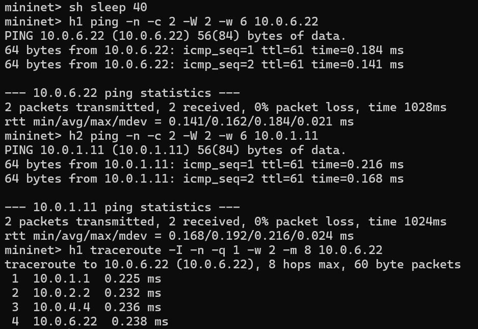
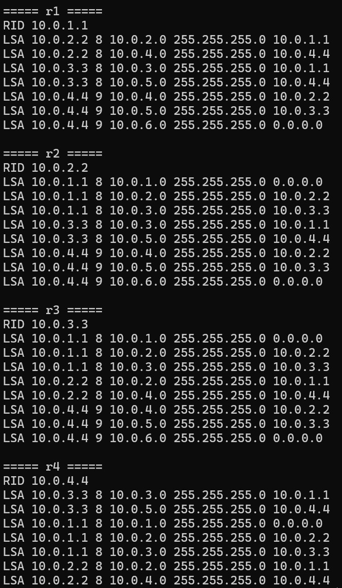
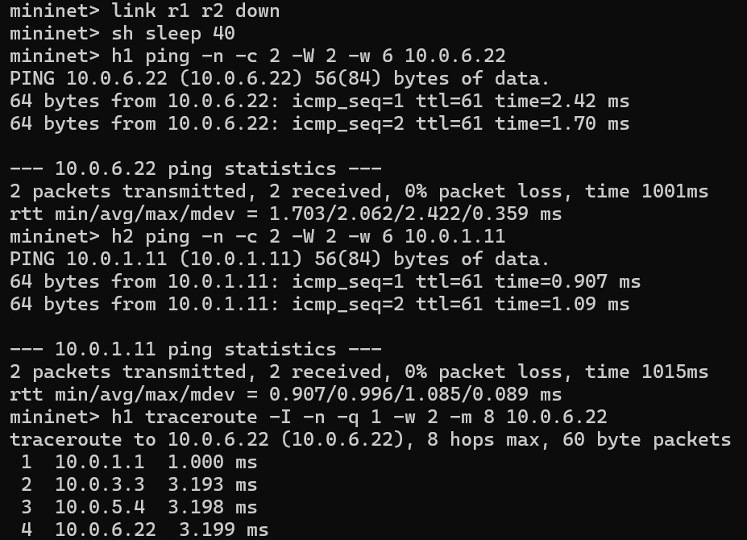
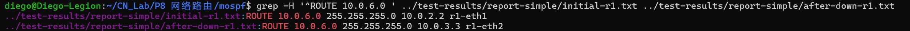
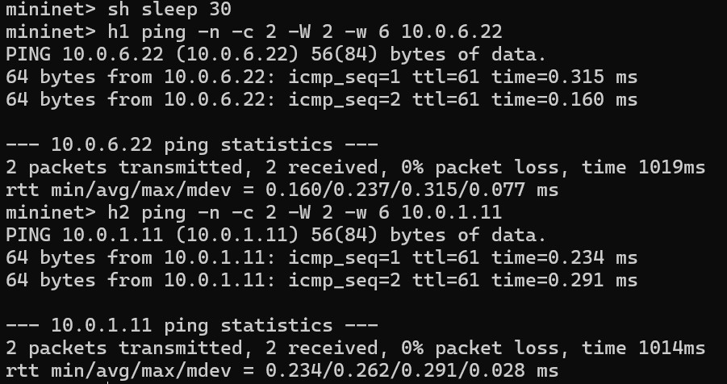
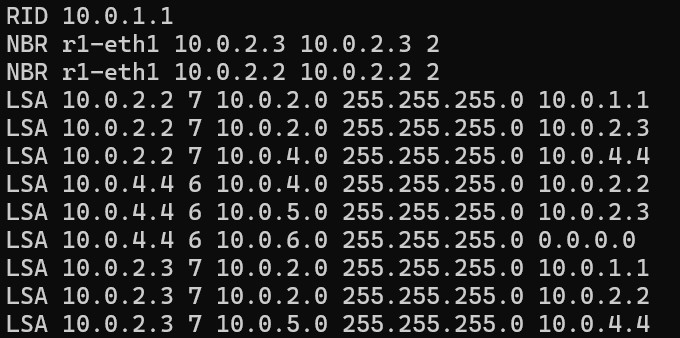
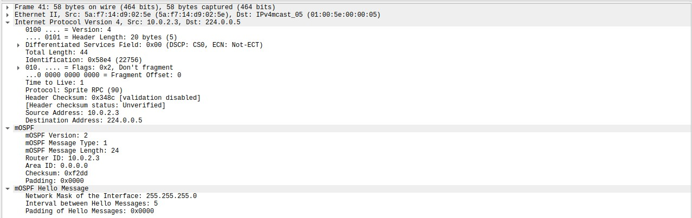
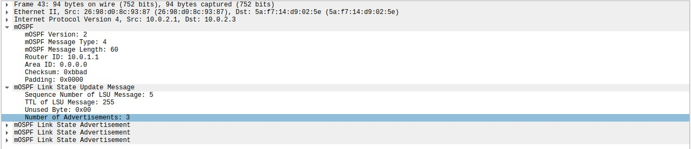

# 网络路由实验报告

张晨轩 2024K8009929011

## 1 实验题目与目的

本实验是在路由器转发实验的基础上展开的，在其中实现一个经过简化的链路状态协议mOSPF。路由器通过Hello报文发现邻居，通过LSU交换链路状态，再依据网络拓扑把动态路由计算出来。实验当中验证了初始连通、原拓扑中断链之后的路径切换，以及交换机与路由器共存时的通信。

## 2 实验原理

### 2.1 邻居发现与链路状态

每一台路由器都以第一接口的IP作为RID，区域ID则设为0。各个接口每5秒发送一次Hello，目的IP为224.0.0.5，目的MAC为01:00:5e:00:00:05。接收方会检查掩码、Hello间隔与所在网段是否相符，然后在该接口的邻居链表当中新增或者刷新邻居。若连续约15秒没有收到Hello，就把该邻居删除，并触发一次通告。

同一个接口有可能通过交换机连接着多台路由器，所以邻居必须按接口分别维护成列表，不能把“一块网卡”当作“只有一个邻居”。

### 2.2 LSU发布、泛洪与数据库

LSU当中携带的是发布者RID、序号、TTL与通告列表，每一条通告表示的都是“网络、掩码、邻居RID”这样一组信息。对于没有路由器邻居的接口，其网络仍然要通告出去，此时邻居RID填0，连接主机的末端网络即属于这种情况。

本机邻居发生变化时会立即发布LSU，进入稳定状态之后每30秒发布一次；新增邻居之后大约1秒还会再补发一次，以减轻多台路由器同时启动时首份LSU被忽略的影响。接收方只接受序号比数据库更新的包，新包在更新数据库之后会向其余接口的邻居继续发送，其中保留原发布者的RID，并把LSU的TTL减1、重新计算mOSPF校验和。序号重复或者偏旧的包不会继续泛洪，也不会刷新旧记录的年龄。某一发布者40秒没有更新时，相应的数据库项即被删除。

### 2.3 最短路与路由表生成

以路由器的RID作为顶点，以邻接关系作为边，链路的代价统一取1，用**Dijkstra算法**求出本机到其余路由器的最少跳数以及各自的前驱。对于远端网络，还要沿前驱链回溯，找出从本机出发的第一跳，再根据本机的邻居表把下一跳IP与出口接口确定下来。

路由所面向的目的对象是网络，而不只是发布者的RID。重算的时候会先保留原有的直连路由，再清除上一轮生成的动态项，然后按距离由近及远把远端通告的网络加入进来；同一个网络只保留已经选定的较近的那条路由。远端路由器之间的边要求双方都通告对应的关系，以便减少断链之后单方旧记录形成虚假通路的可能。

## 3 程序实现

### 3.1 Hello处理

下面给出的是`handle_mospf_hello`的完整实现。对于已有的邻居，通常只刷新其存活时间；当出现新增邻居，或者已有邻居的IP发生变化时，则触发一次新的LSU；补发定时器用于处理启动阶段各节点邻居发现先后不一致的问题。

```c
void handle_mospf_hello(iface_info_t *iface, const char *packet, int len){
	(void)len;
	struct iphdr *ip = packet_to_ip_hdr(packet);
	struct mospf_hdr *message = (struct mospf_hdr *)IP_DATA(ip);
	struct mospf_hello *hello = (struct mospf_hello *)(message+1);
	u32 rid = ntohl(message->rid), address = ntohl(ip->saddr);
	if(rid==0 || rid==instance->router_id || ntohl(hello->mask)!=iface->mask ||
		ntohs(hello->helloint)!=iface->helloint || (address&iface->mask)!=(iface->ip&iface->mask)){
		return;
	}
	mospf_nbr_t *nbr;
	list_for_each_entry(nbr, &iface->nbr_list, list){
		if(nbr->nbr_id == rid){
			int changed = nbr->nbr_ip!=address;
			nbr->nbr_ip = address;
			nbr->alive = 0;
			if(changed){
				originate_lsu();
				startup_refresh = time(NULL)+1;
			}
			return;
		}
	}
	nbr = calloc(1, sizeof(*nbr));
	if(nbr == NULL){
		return;
	}
	nbr->nbr_id = rid;
	nbr->nbr_ip = address;
	nbr->nbr_mask = iface->mask;
	list_add_tail(&nbr->list, &iface->nbr_list);
	iface->num_nbr += 1;
	originate_lsu();
	startup_refresh = time(NULL)+1;
}
```

### 3.2 LSU接收与泛洪

下面给出的是`handle_mospf_lsu`的完整实现。该函数进一步验证上一跳邻居与序号是否合法。数据库当中保留的是原发布者的通告，而外层IP的源地址在逐跳发送时使用当前出口接口的地址。

```c
void handle_mospf_lsu(iface_info_t *iface, char *packet, int len){
	(void)len;
	struct iphdr *ip = packet_to_ip_hdr(packet);
	struct mospf_hdr *message = (struct mospf_hdr *)IP_DATA(ip);
	struct mospf_lsu *lsu = (struct mospf_lsu *)(message+1);
	u32 rid = ntohl(message->rid);
	if(rid==0 || rid==instance->router_id){
		return;
	}
	mospf_nbr_t *nbr;
	int sender_known = 0;
	list_for_each_entry(nbr, &iface->nbr_list, list){
		if(nbr->nbr_ip == ntohl(ip->saddr)){
			sender_known = 1;
		}
	}
	if(!sender_known){
		return;
	}
	u16 seq = ntohs(lsu->seq);
	mospf_db_entry_t *db = NULL, *current;
	list_for_each_entry(current, &mospf_db, list){
		if(current->rid == rid){
			db = current;
			break;
		}
	}
	if(db!=NULL && (short)(seq-db->seq)<=0){
		return;
	}
	int count = ntohl(lsu->nadv);
	struct mospf_lsa *array = count ? malloc(count*MOSPF_LSA_SIZE) : NULL;
	if(count!=0 && array==NULL){
		return;
	}
	if(count){
		memcpy(array, lsu+1, count*MOSPF_LSA_SIZE);
	}
	if(db == NULL){
		db = calloc(1, sizeof(*db));
		if(db == NULL){
			free(array);
			return;
		}
		db->rid = rid;
		list_add_tail(&db->list, &mospf_db);
	}
	free(db->array);
	db->array = array;
	db->nadv = count;
	db->seq = seq;
	db->alive = 0;
	mospf_recompute_routes();
	save_state();
	if(lsu->ttl <= 1){
		return;
	}
	lsu->ttl -= 1;
	message->checksum = mospf_checksum(message);
	iface_info_t *output;
	list_for_each_entry(output, &instance->iface_list, list){
		if(output == iface){
			continue;
		}
		list_for_each_entry(nbr, &output->nbr_list, list){
			send_lsu_to(output, nbr, message, ntohs(message->len));
		}
	}
}
```

### 3.3 Dijkstra与路由更新

其中`dist`记录最短距离，`prev`记录前驱，`used`则标记已经确定的节点；不可达的节点保持`INT_MAX`，不能继续参与加法运算。

```c
	for(int step=0; step<count; ++step){
		int u = -1;
		for(int i=0; i<count; ++i){
			if(!used[i] && dist[i]!=INT_MAX &&
				(u<0 || dist[i]<dist[u] || (dist[i]==dist[u] && ids[i]<ids[u]))){
				u = i;
			}
		}
		if(u < 0){
			break;
		}
		used[u] = 1;
		for(int v=0; v<count; ++v){
			if(!used[v] && graph[u*count+v] && dist[u]+1<dist[v]){
				dist[v] = dist[u]+1;
				prev[v] = u;
			}
		}
	}
```

得到前驱之后沿链回溯，直到找到本机的直接邻居，再把这个邻居的接口IP用作网关。动态路由带有独立的标记，重算时只删除带该标记的项，启动时读取到的直连项则予以保留。数据库、邻居变化与路由重算都由`mospf_lock`串行处理；路由表另外用`rtable_lock`加以保护，查找结果会复制到线程独立的存储当中再返回，以免原表项在解锁之后被重算释放掉。

## 4 网络拓扑

### 4.1 六节点拓扑

```text
          r2
        /    \
h1 — r1      r4 — h2
        \    /
          r3
```

| 链路 | 左端IP | 右端IP |
| --- | --- | --- |
| h1—r1 | 10.0.1.11 | 10.0.1.1 |
| r1—r2 | 10.0.2.1 | 10.0.2.2 |
| r1—r3 | 10.0.3.1 | 10.0.3.3 |
| r2—r4 | 10.0.4.2 | 10.0.4.4 |
| r3—r4 | 10.0.5.3 | 10.0.5.4 |
| r4—h2 | 10.0.6.4 | 10.0.6.22 |

所有接口的掩码均为/24。h1的默认网关为10.0.1.1，h2的默认网关为10.0.6.4；r1、r2、r3、r4的RID分别为10.0.1.1、10.0.2.2、10.0.3.3、10.0.4.4。

### 4.2 交换机共存拓扑

```text
h1 — r1 — s1 — r2 — r4 — h2
           \         /
             r3 ————
```

s1上运行的是P3的用户态交换机程序，没有启用内核网桥。r1、r2、r3在共享的10.0.2.0/24网段中分别使用10.0.2.1、10.0.2.2、10.0.2.3；r2—r4、r3—r4以及两端主机的链路沿用上表。r3的第一接口改为10.0.2.3，因此在当前拓扑当中，r3的RID也是10.0.2.3。

## 5 实验流程与结果

### 5.1 编译与自动测试

在`mospf/`目录当中执行下面的命令：

```bash
make clean
make
sudo python3 lab_test.py
```

用原始的Makefile编译即可得到`mospfd`。本地脚本会自动把拓扑建立起来、启动各个程序，并把状态与抓包结果保存下来；验收时按初始观察40秒、断链之后再观察40秒的方式来安排。

输出的内容如下：

```
diego@Diego-Legion:~/CN_Lab/P8 网络路由/mospf$ sudo python3 lab_test.py
[sudo] password for diego:
Waiting 40s for simple convergence.
initial r1
RID 10.0.1.1
NBR r1-eth1 10.0.2.2 10.0.2.2 2
NBR r1-eth2 10.0.3.3 10.0.3.3 2
LSA 10.0.2.2 4 10.0.2.0 255.255.255.0 10.0.1.1
LSA 10.0.2.2 4 10.0.4.0 255.255.255.0 10.0.4.4
LSA 10.0.3.3 4 10.0.3.0 255.255.255.0 10.0.1.1
LSA 10.0.3.3 4 10.0.5.0 255.255.255.0 10.0.4.4
LSA 10.0.4.4 4 10.0.4.0 255.255.255.0 10.0.2.2
LSA 10.0.4.4 4 10.0.5.0 255.255.255.0 10.0.3.3
LSA 10.0.4.4 4 10.0.6.0 255.255.255.0 0.0.0.0
ROUTE 10.0.1.0 255.255.255.0 0.0.0.0 r1-eth0
ROUTE 10.0.2.0 255.255.255.0 0.0.0.0 r1-eth1
ROUTE 10.0.3.0 255.255.255.0 0.0.0.0 r1-eth2
ROUTE 10.0.4.0 255.255.255.0 10.0.2.2 r1-eth1
ROUTE 10.0.5.0 255.255.255.0 10.0.3.3 r1-eth2
ROUTE 10.0.6.0 255.255.255.0 10.0.2.2 r1-eth1
initial r2
RID 10.0.2.2
NBR r2-eth0 10.0.1.1 10.0.2.1 2
NBR r2-eth1 10.0.4.4 10.0.4.4 1
LSA 10.0.1.1 4 10.0.1.0 255.255.255.0 0.0.0.0
LSA 10.0.1.1 4 10.0.2.0 255.255.255.0 10.0.2.2
LSA 10.0.1.1 4 10.0.3.0 255.255.255.0 10.0.3.3
LSA 10.0.4.4 4 10.0.4.0 255.255.255.0 10.0.2.2
LSA 10.0.4.4 4 10.0.5.0 255.255.255.0 10.0.3.3
LSA 10.0.4.4 4 10.0.6.0 255.255.255.0 0.0.0.0
LSA 10.0.3.3 4 10.0.3.0 255.255.255.0 10.0.1.1
LSA 10.0.3.3 4 10.0.5.0 255.255.255.0 10.0.4.4
ROUTE 10.0.2.0 255.255.255.0 0.0.0.0 r2-eth0
ROUTE 10.0.4.0 255.255.255.0 0.0.0.0 r2-eth1
ROUTE 10.0.1.0 255.255.255.0 10.0.2.1 r2-eth0
ROUTE 10.0.3.0 255.255.255.0 10.0.2.1 r2-eth0
ROUTE 10.0.5.0 255.255.255.0 10.0.4.4 r2-eth1
ROUTE 10.0.6.0 255.255.255.0 10.0.4.4 r2-eth1
initial r3
RID 10.0.3.3
NBR r3-eth0 10.0.1.1 10.0.3.1 2
NBR r3-eth1 10.0.4.4 10.0.5.4 2
LSA 10.0.1.1 4 10.0.1.0 255.255.255.0 0.0.0.0
LSA 10.0.1.1 4 10.0.2.0 255.255.255.0 10.0.2.2
LSA 10.0.1.1 4 10.0.3.0 255.255.255.0 10.0.3.3
LSA 10.0.4.4 4 10.0.4.0 255.255.255.0 10.0.2.2
LSA 10.0.4.4 4 10.0.5.0 255.255.255.0 10.0.3.3
LSA 10.0.4.4 4 10.0.6.0 255.255.255.0 0.0.0.0
LSA 10.0.2.2 4 10.0.2.0 255.255.255.0 10.0.1.1
LSA 10.0.2.2 4 10.0.4.0 255.255.255.0 10.0.4.4
ROUTE 10.0.3.0 255.255.255.0 0.0.0.0 r3-eth0
ROUTE 10.0.5.0 255.255.255.0 0.0.0.0 r3-eth1
ROUTE 10.0.1.0 255.255.255.0 10.0.3.1 r3-eth0
ROUTE 10.0.2.0 255.255.255.0 10.0.3.1 r3-eth0
ROUTE 10.0.4.0 255.255.255.0 10.0.5.4 r3-eth1
ROUTE 10.0.6.0 255.255.255.0 10.0.5.4 r3-eth1
initial r4
RID 10.0.4.4
NBR r4-eth0 10.0.2.2 10.0.4.2 2
NBR r4-eth1 10.0.3.3 10.0.5.3 2
LSA 10.0.2.2 4 10.0.2.0 255.255.255.0 10.0.1.1
LSA 10.0.2.2 4 10.0.4.0 255.255.255.0 10.0.4.4
LSA 10.0.1.1 4 10.0.1.0 255.255.255.0 0.0.0.0
LSA 10.0.1.1 4 10.0.2.0 255.255.255.0 10.0.2.2
LSA 10.0.1.1 4 10.0.3.0 255.255.255.0 10.0.3.3
LSA 10.0.3.3 4 10.0.3.0 255.255.255.0 10.0.1.1
LSA 10.0.3.3 4 10.0.5.0 255.255.255.0 10.0.4.4
ROUTE 10.0.4.0 255.255.255.0 0.0.0.0 r4-eth0
ROUTE 10.0.5.0 255.255.255.0 0.0.0.0 r4-eth1
ROUTE 10.0.6.0 255.255.255.0 0.0.0.0 r4-eth2
ROUTE 10.0.2.0 255.255.255.0 10.0.4.2 r4-eth0
ROUTE 10.0.3.0 255.255.255.0 10.0.5.3 r4-eth1
ROUTE 10.0.1.0 255.255.255.0 10.0.4.2 r4-eth0
PASS initial_database_r1
PASS initial_database_r2
PASS initial_database_r3
PASS initial_database_r4
h1$ ping -n -c 2 -W 2 -w 6 10.0.6.22
PING 10.0.6.22 (10.0.6.22) 56(84) bytes of data.
64 bytes from 10.0.6.22: icmp_seq=1 ttl=61 time=0.188 ms
64 bytes from 10.0.6.22: icmp_seq=2 ttl=61 time=0.143 ms

--- 10.0.6.22 ping statistics ---
2 packets transmitted, 2 received, 0% packet loss, time 1026ms
rtt min/avg/max/mdev = 0.143/0.165/0.188/0.022 ms
PASS initial_ping_h1
h2$ ping -n -c 2 -W 2 -w 6 10.0.1.11
PING 10.0.1.11 (10.0.1.11) 56(84) bytes of data.
64 bytes from 10.0.1.11: icmp_seq=1 ttl=61 time=0.196 ms
64 bytes from 10.0.1.11: icmp_seq=2 ttl=61 time=0.170 ms

--- 10.0.1.11 ping statistics ---
2 packets transmitted, 2 received, 0% packet loss, time 1018ms
rtt min/avg/max/mdev = 0.170/0.183/0.196/0.013 ms
PASS initial_ping_h2
h1$ traceroute -I -n -q 1 -w 2 -m 8 10.0.6.22
traceroute to 10.0.6.22 (10.0.6.22), 8 hops max, 60 byte packets
 1  10.0.1.1  0.028 ms
 2  10.0.2.2  0.077 ms
 3  10.0.4.4  0.116 ms
 4  10.0.6.22  0.117 ms
PASS initial_trace
link r1 r2 down; wait 40s
after-down r1
RID 10.0.1.1
NBR r1-eth2 10.0.3.3 10.0.3.3 2
LSA 10.0.2.2 5 10.0.2.0 255.255.255.0 0.0.0.0
LSA 10.0.2.2 5 10.0.4.0 255.255.255.0 10.0.4.4
LSA 10.0.3.3 5 10.0.3.0 255.255.255.0 10.0.1.1
LSA 10.0.3.3 5 10.0.5.0 255.255.255.0 10.0.4.4
LSA 10.0.4.4 5 10.0.4.0 255.255.255.0 10.0.2.2
LSA 10.0.4.4 5 10.0.5.0 255.255.255.0 10.0.3.3
LSA 10.0.4.4 5 10.0.6.0 255.255.255.0 0.0.0.0
ROUTE 10.0.1.0 255.255.255.0 0.0.0.0 r1-eth0
ROUTE 10.0.2.0 255.255.255.0 0.0.0.0 r1-eth1
ROUTE 10.0.3.0 255.255.255.0 0.0.0.0 r1-eth2
ROUTE 10.0.5.0 255.255.255.0 10.0.3.3 r1-eth2
ROUTE 10.0.4.0 255.255.255.0 10.0.3.3 r1-eth2
ROUTE 10.0.6.0 255.255.255.0 10.0.3.3 r1-eth2
after-down r2
RID 10.0.2.2
NBR r2-eth1 10.0.4.4 10.0.4.4 2
LSA 10.0.1.1 5 10.0.1.0 255.255.255.0 0.0.0.0
LSA 10.0.1.1 5 10.0.2.0 255.255.255.0 0.0.0.0
LSA 10.0.1.1 5 10.0.3.0 255.255.255.0 10.0.3.3
LSA 10.0.4.4 5 10.0.4.0 255.255.255.0 10.0.2.2
LSA 10.0.4.4 5 10.0.5.0 255.255.255.0 10.0.3.3
LSA 10.0.4.4 5 10.0.6.0 255.255.255.0 0.0.0.0
LSA 10.0.3.3 5 10.0.3.0 255.255.255.0 10.0.1.1
LSA 10.0.3.3 5 10.0.5.0 255.255.255.0 10.0.4.4
ROUTE 10.0.2.0 255.255.255.0 0.0.0.0 r2-eth0
ROUTE 10.0.4.0 255.255.255.0 0.0.0.0 r2-eth1
ROUTE 10.0.5.0 255.255.255.0 10.0.4.4 r2-eth1
ROUTE 10.0.6.0 255.255.255.0 10.0.4.4 r2-eth1
ROUTE 10.0.3.0 255.255.255.0 10.0.4.4 r2-eth1
ROUTE 10.0.1.0 255.255.255.0 10.0.4.4 r2-eth1
after-down r3
RID 10.0.3.3
NBR r3-eth0 10.0.1.1 10.0.3.1 2
NBR r3-eth1 10.0.4.4 10.0.5.4 2
LSA 10.0.1.1 5 10.0.1.0 255.255.255.0 0.0.0.0
LSA 10.0.1.1 5 10.0.2.0 255.255.255.0 0.0.0.0
LSA 10.0.1.1 5 10.0.3.0 255.255.255.0 10.0.3.3
LSA 10.0.4.4 5 10.0.4.0 255.255.255.0 10.0.2.2
LSA 10.0.4.4 5 10.0.5.0 255.255.255.0 10.0.3.3
LSA 10.0.4.4 5 10.0.6.0 255.255.255.0 0.0.0.0
LSA 10.0.2.2 5 10.0.2.0 255.255.255.0 0.0.0.0
LSA 10.0.2.2 5 10.0.4.0 255.255.255.0 10.0.4.4
ROUTE 10.0.3.0 255.255.255.0 0.0.0.0 r3-eth0
ROUTE 10.0.5.0 255.255.255.0 0.0.0.0 r3-eth1
ROUTE 10.0.1.0 255.255.255.0 10.0.3.1 r3-eth0
ROUTE 10.0.2.0 255.255.255.0 10.0.3.1 r3-eth0
ROUTE 10.0.4.0 255.255.255.0 10.0.5.4 r3-eth1
ROUTE 10.0.6.0 255.255.255.0 10.0.5.4 r3-eth1
after-down r4
RID 10.0.4.4
NBR r4-eth0 10.0.2.2 10.0.4.2 2
NBR r4-eth1 10.0.3.3 10.0.5.3 2
LSA 10.0.2.2 5 10.0.2.0 255.255.255.0 0.0.0.0
LSA 10.0.2.2 5 10.0.4.0 255.255.255.0 10.0.4.4
LSA 10.0.1.1 5 10.0.1.0 255.255.255.0 0.0.0.0
LSA 10.0.1.1 5 10.0.2.0 255.255.255.0 0.0.0.0
LSA 10.0.1.1 5 10.0.3.0 255.255.255.0 10.0.3.3
LSA 10.0.3.3 5 10.0.3.0 255.255.255.0 10.0.1.1
LSA 10.0.3.3 5 10.0.5.0 255.255.255.0 10.0.4.4
ROUTE 10.0.4.0 255.255.255.0 0.0.0.0 r4-eth0
ROUTE 10.0.5.0 255.255.255.0 0.0.0.0 r4-eth1
ROUTE 10.0.6.0 255.255.255.0 0.0.0.0 r4-eth2
ROUTE 10.0.2.0 255.255.255.0 10.0.4.2 r4-eth0
ROUTE 10.0.3.0 255.255.255.0 10.0.5.3 r4-eth1
ROUTE 10.0.1.0 255.255.255.0 10.0.5.3 r4-eth1
PASS after-down_database_r1
PASS after-down_database_r2
PASS after-down_database_r3
PASS after-down_database_r4
h1$ ping -n -c 2 -W 2 -w 6 10.0.6.22
PING 10.0.6.22 (10.0.6.22) 56(84) bytes of data.
64 bytes from 10.0.6.22: icmp_seq=1 ttl=61 time=2.52 ms
64 bytes from 10.0.6.22: icmp_seq=2 ttl=61 time=1.21 ms

--- 10.0.6.22 ping statistics ---
2 packets transmitted, 2 received, 0% packet loss, time 1002ms
rtt min/avg/max/mdev = 1.212/1.865/2.518/0.653 ms
PASS after_down_ping_h1
h2$ ping -n -c 2 -W 2 -w 6 10.0.1.11
PING 10.0.1.11 (10.0.1.11) 56(84) bytes of data.
64 bytes from 10.0.1.11: icmp_seq=1 ttl=61 time=0.303 ms
64 bytes from 10.0.1.11: icmp_seq=2 ttl=61 time=13.3 ms

--- 10.0.1.11 ping statistics ---
2 packets transmitted, 2 received, 0% packet loss, time 1010ms
rtt min/avg/max/mdev = 0.303/6.777/13.252/6.474 ms
PASS after_down_ping_h2
h1$ traceroute -I -n -q 1 -w 2 -m 8 10.0.6.22
traceroute to 10.0.6.22 (10.0.6.22), 8 hops max, 60 byte packets
 1  10.0.1.1  0.785 ms
 2  10.0.3.3  1.874 ms
 3  10.0.5.4  1.883 ms
 4  10.0.6.22  1.884 ms
PASS alternate_path
PASS router_stdout_empty
PASS processes_alive
16/16 checks passed; /mnt/c/Users/30130/desktop/CN_Lab/P8 网络路由/test-results/run-20261102-195940
```

### 5.2 初始连通与数据库一致性

六节点拓扑运行40秒之后，双向ping得到的结果如下表所示：

| 源节点 | 目的IP | 发送/接收 | 丢包率 | 应答TTL |
| --- | --- | --- | --- | --- |
| h1 | 10.0.6.22 | 2/2 | 0% | 61 |
| h2 | 10.0.1.11 | 2/2 | 0% | 61 |

```text
10.0.1.1 → 10.0.2.2 → 10.0.4.4 → 10.0.6.22
```

traceroute显示数据是经过r1、r2、r4到达h2的。应答TTL由主机初始的64减为61，与经过3台路由器的情况相符。



各台路由器都保存着其余3个发布者的LSU，本机通告则直接来自邻居表，不会重复插入本机的数据库。按发布者RID逐一比较，其网络、掩码与邻居RID所构成的通告集合，在其余节点中的副本是一致的。



### 5.3 原拓扑断链与恢复

在既未退出、也未重建的同一个Mininet拓扑当中，把初始路径实际经过的r1—r2链路断开，等待40秒之后再重新测试：

```text
link r1 r2 down
sh sleep 40
h1 ping -n -c 2 -W 2 -w 6 10.0.6.22
h2 ping -n -c 2 -W 2 -w 6 10.0.1.11
h1 traceroute -I -n -q 1 -w 2 -m 8 10.0.6.22
```

| 阶段 | h1→h2发送/接收 | h2→h1发送/接收 | 路径 |
| --- | --- | --- | --- |
| 断链前 | 2/2 | 2/2 | r1→r2→r4→h2 |
| 断链后等待40秒 | 2/2 | 2/2 | r1→r3→r4→h2 |

断链之后得到的地址序列如下：

```text
10.0.1.1 → 10.0.3.3 → 10.0.5.4 → 10.0.6.22
```



| r1到10.0.6.0/24的路由 | 下一跳 | 出口 |
| --- | --- | --- |
| 断链前 | 10.0.2.2 | r1-eth1 |
| 断链后 | 10.0.3.3 | r1-eth2 |



断链之后Hello不再到达，邻居在超时之后触发了新的LSU；其余节点随即更新拓扑并重算路径。结果表明，在测试窗口之内通信已经恢复。

### 5.4 交换机共存测试

运行P3交换机与四个mospfd，等待30秒之后，h1到h2以及h2到h1都是2次发送、2次接收、0%丢包，应答TTL均为61。r1的同一个`r1-eth1`接口同时发现了10.0.2.2与10.0.2.3两个邻居；四台路由器的远端LSA副本经核对是一致的。





交换机只负责二层转发，并不参与Dijkstra；其作用在于让同一网段中的多台路由器能够交换Hello和LSU。转发数据的时候，仍由路由器依据目的IP来选择下一跳，这说明二层邻接与三层路由可以配合工作。

### 5.5 报文与OJ验收

本地抓包检查的内容覆盖了IP protocol 90、版本2、Hello组播地址、Hello间隔、LSU通告数量、长度、字节序以及IP/mOSPF校验和。所用的过滤规则分别为`mospf.type==1`与`mospf.type==4`。





OJ测试结果如下：


## 6 调试过程与结果分析

### 6.1 ping成功不代表数据库已经完整

在初次进行的交换机拓扑测试当中，30秒时两端主机已经能够ping通，但部分路由器缺少r3的LSU。只要存在一条可用路径，主机的通信就有保障，因此仅凭ping的检查会把这个疏漏掩盖过去。

检查启动过程时发现，发送方发现邻居并立即发出LSU的时候，接收方有可能还没有收到它的Hello，于是因为来源邻居未知而把这个LSU忽略掉。倘若等到下一次30秒的周期发布，就有可能超出本轮数据库的观察窗口。为此在新增邻居触发立即发布之后，大约1秒再补发一次；重新测试时除了检查ping之外，还比较了四台路由器中的同源通告集合，数据库随之恢复一致。

### 6.2 路由重算不能删除直连表项

初始的直连表项来自接口配置，动态路由来自远端通告，两者的生命周期并不相同。如果在每次计算之前都把整个路由表清空，本机到直连主机与下一跳的发送就可能无法正常进行。实现当中为动态项添加了独立的标记，只替换这些带标记的项；同时对同前缀的路由优先保留直连路由。断链测试则用路由快照与实际路径共同确认结果，以免只检查数据结构而没有验证转发是否生效。

## 7 实验结论与体会

本实验实现了Hello邻居发现、LSU泛洪、链路状态数据库以及基于Dijkstra的动态路由。六节点拓扑在40秒的观察点上能够双向通信，原路径断链之后的40秒观察点上则改用了备用路径；交换机共存拓扑在30秒的观察点上实现了通信，远端通告也保持一致。

与P6相比，本实验进一步展示了路由表背后的信息来源。ARP只负责在下一跳确定之后完成MAC解析，Hello负责找到本地的路由器邻居，LSU让节点了解远端的连接关系，最短路算法再把这些信息转换成转发项。上述环节只要缺少任何一个，都有可能出现“收到控制消息却不能转发”，或者“某条路径可用但全局信息不完整”的情况。
