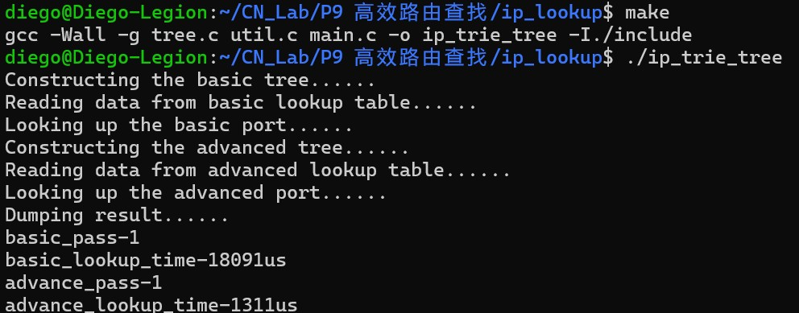
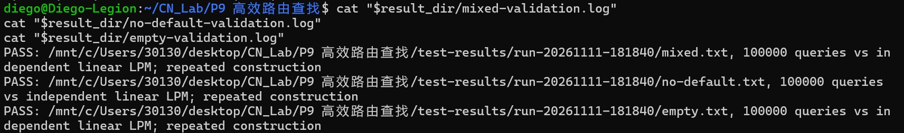
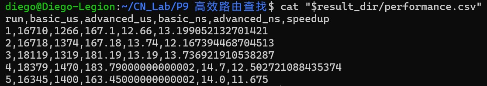
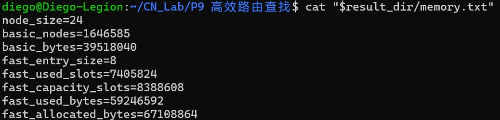

# 高效IP路由查找实验报告

张晨轩 2024K8009929011

## 1 实验题目与目的

本实验实现的是基本的二叉前缀树与经过优化的多比特前缀树，在给定的转发表上完成IPv4最长前缀匹配，并对两种结构的正确性、查找耗时以及内存开销加以比较。

此前的路由实验解决的是路由从哪里产生、报文又如何转发的问题。本实验则进一步考虑，当转发表中包含大量前缀的时候，怎样才能更快地找到对应的端口。

## 2 实验原理

### 2.1 最长前缀匹配

同一个IP有可能命中多条路由，此时应当选择前缀长度最长的那一条。例如在存在`128.0.0.0/1→3`与`128.0.0.0/2→4`的情况下，查询128.0.0.0应当返回4，不能把输入行当中的端口直接当作正确答案。

匹配条件是`(IP & mask)==(network & mask)`。程序需要支持/0默认路由、/32主机路由以及任意中间长度的前缀；在没有匹配项时返回`UINT32_MAX`，其无符号表示与接口所要求的-1相对应。

### 2.2 基本二叉前缀树

插入时从IP的最高位开始逐位进行，遇到0走左子树，遇到1走右子树，前缀末端被标记为匹配节点并保存端口。查找时沿IP的路径一路向下，随时把最近遇到的匹配节点记录下来；一旦遇到空子树，或者已经走完32位，就把记录下来的值返回。这样一来，即使更长的路径并不存在，已经命中的较短前缀也不会丢失。

IPv4地址的宽度固定为32位，一次查找最多访问根节点以及32个下层节点。主要开销来自逐位的判断和依次依赖的指针访问；与逐条扫描转发表相比，其查找步数并不会随前缀条目数线性增长。

### 2.3 优化的16/8/8位多比特树

优化版一次使用较多的地址位来索引子表：第一层取高16位，第二层取接下来的8位，第三层则取末端的8位。一次查找最多读取3个槽，每个槽当中包含端口与子表偏移，两者各占4字节。

第一层固定为65536个槽，第二层与第三层则按需要创建，每个子表包含256个槽。创建子表的时候，会把父槽保存的端口传播到全部子槽，再让更长的前缀覆盖相应的范围。例如一个/17前缀会覆盖第二层中的128个槽；/25前缀则会覆盖第三层中的128个槽。这样即使是并非整字节的前缀，也能够得到精确的匹配。

构造时按前缀长度由短到长依次处理，以保证短前缀不会覆盖长前缀。长度相同的条目保持原文件中的顺序，完全重复的前缀则由后出现的记录覆盖。查询时叶子上已经保存了最长匹配的结果，无需再做额外的回溯。

## 3 程序实现

### 3.1 基本树查找

下面给出的是`lookup_tree`的完整实现。根节点能够保存默认路由，每遇到一个匹配节点就更新一次`best`；内部节点只用于表示路径，不能当作有效前缀来看待。

```c
uint32_t *lookup_tree(uint32_t* ip_vec){
    uint32_t *ports = checked_alloc(TEST_SIZE*sizeof(*ports));
    for(int i=0; i<TEST_SIZE; ++i){
        node_t *node = basic_root;
        uint32_t best = UINT32_MAX;
        if(node!=NULL && node->type==M_NODE){
            best = node->port;
        }
        for(int bit=31; bit>=0 && node!=NULL; --bit){
            node = ((ip_vec[i]>>bit)&1) ? node->rchild : node->lchild;
            if(node!=NULL && node->type==M_NODE){
                best = node->port;
            }
        }
        ports[i] = best;
    }
    return ports;
}
```

### 3.2 优化表项与子表扩展

优化后的结构用整数下标来连接子表，以免扩容时`realloc`移动内存而导致旧指针失效。判断子表是否存在时使用独立的`child`字段，不占用端口的高位。

```c
typedef struct {
    uint32_t port;
    uint32_t child;
} fast_entry;
```

下面的函数负责创建子表并继承父槽的结果。`allocate_table`会把全部新槽初始化为继承端口、没有子表的状态，然后返回子表的起始下标。

```c
static uint32_t extend_slot(uint32_t slot){
    if(fast_table[slot].child == UINT32_MAX){
        uint32_t inherited = fast_table[slot].port;
        uint32_t child = allocate_table(256, inherited);
        fast_table[slot].child = child;
    }
    return fast_table[slot].child;
}
```

### 3.3 优化树查找

下面给出的是`lookup_tree_advance`的完整实现。前16位直接用于索引第一层，只有在存在子表的时候才继续读取后8位，因此最多进行3次表项读取。

```c
uint32_t *lookup_tree_advance(uint32_t *ip_vec){
    uint32_t *ports = checked_alloc(TEST_SIZE*sizeof(*ports));
    for(int i=0; i<TEST_SIZE; ++i){
        uint32_t ip = ip_vec[i];
        fast_entry entry = fast_table[ip>>16];
        if(entry.child != UINT32_MAX){
            entry = fast_table[entry.child+((ip>>8)&255)];
            if(entry.child != UINT32_MAX){
                entry = fast_table[entry.child+(ip&255)];
            }
        }
        ports[i] = entry.port;
    }
    return ports;
}
```

## 4 实验环境与流程

### 4.1 编译与原始数据验证

在`ip_lookup/`目录当中运行下面的命令：

```bash
make
./ip_trie_tree
```

图1中的单次运行得到的基本版与优化版正确性标志都是1，批量查找的耗时分别为18091us与1311us。这一次运行只用于验证原始入口，后续的性能比较则采用图3中的五轮独立运行结果。



### 4.2 独立正确性与内存安全核对

这里使用独立的线性最长前缀扫描作为判定基准，再把基准的结果与两种树实现的输出逐一比对。每一组进行100000次查询，同时启用AddressSanitizer与UndefinedBehaviorSanitizer，并重复建树，以便检查旧结构的释放以及初始化情况。

| 数据组 | 重点 | 查询次数 | 结果 |
| --- | --- | --- | --- |
| mixed | /0—/32、嵌套、乱序、重复前缀、非规范网络地址、端口0 | 100000 | 两版均与独立基准一致 |
| no-default | 无默认路由、未命中、短前缀与主机路由 | 100000 | 两版均与独立基准一致 |
| empty | 空转发表 | 100000 | 全部返回未命中 |



### 4.3 查找性能

针对同一张给定的转发表，独立运行原程序5轮，编译选项保持一致。计时的位置沿用`main.c`中的安排：只包围整批lookup函数的调用，不包括文件的读取与建树过程，但包含函数内部结果数组的分配与写入。

| 轮次 | 基本版批量耗时/us | 优化版批量耗时/us | 基本版平均/ns | 优化版平均/ns | 加速比 |
| --- | --- | --- | --- | --- | --- |
| 1 | 16710 | 1266 | 167.10 | 12.66 | 13.20 |
| 2 | 16718 | 1374 | 167.18 | 13.74 | 12.17 |
| 3 | 18119 | 1319 | 181.19 | 13.19 | 13.74 |
| 4 | 18379 | 1470 | 183.79 | 14.70 | 12.50 |
| 5 | 16345 | 1400 | 163.45 | 14.00 | 11.68 |

每轮查询100000次，平均单次耗时按“批量耗时(us)×1000÷100000”换算成纳秒。两版批量时间的中位数分别为16718us与1374us，对应的平均查找时间为167.18ns与13.74ns；两者的中位数之比约为12.17。五轮当中最低的加速比约为11.68，均超过了2倍的要求。



### 4.4 内存开销

基本树是把所有节点的`sizeof(node_t)`之和相加，以此统计数据结构的大小；优化树则按arena实际分配的容量乘以槽大小来计算，不能只统计已经使用的槽。

| 项目 | 基本二叉树 | 优化多比特树 |
| --- | --- | --- |
| 节点或槽大小 | 24字节 | 8字节 |
| 节点数或已用槽数 | 1646585 | 7405824 |
| 已用结构字节数 | 39518040 | 59246592 |
| 实际分配容量对应字节数 | 39518040 | 67108864 |
| 实际结构内存/MiB | 37.69 | 64.00 |

优化版的arena按倍增策略分配，保留着8388608个槽的容量，其中尚未使用的容量仍然属于已经分配的内存，必须计入。优化版的结构内存约为基本版的1.70倍，增加了约69.82%，这说明本实现是用更多的空间换取了更少的查找层数。



## 5 调试与结果分析

### 5.1 用边界数据核对最长匹配

不能把给定行当中的端口直接当作该行IP的查询结果，因为同一个IP有可能命中更长的前缀。核对时把基本树与优化树分别同独立的线性扫描对照，并加入重复前缀、未命中以及端口0的数据，以检查“是否匹配”与“端口值”是否被混用。

优化版在跨越16位与24位边界的时候，需要在创建子表的那一刻把父槽的结果复制过去。如果新槽被初始化为未命中，那么落入子表却没有命中长前缀的IP，就无法返回原有的短前缀端口。本实现通过继承端口以及按长度递增插入的方式保持了这一语义，三组测试与原始数据均通过。

### 5.2 OJ测试


## 6 实验结论

实验说明，正确的路由查找既要处理前缀之间的重叠，也要考虑数据结构的访问方式。本次的多比特实现把最多32位的逐位查找压缩为最多3层查表，本轮五次测量中两版耗时中位数之比约为12.17，代价是结构内存由37.69MiB增至64.00MiB。与前面的动态路由实验结合起来看，路由协议负责产生正确的转发表，高效的查找结构则负责让每个报文能够更快地使用这张表；两者共同影响着路由器的实际转发能力。
